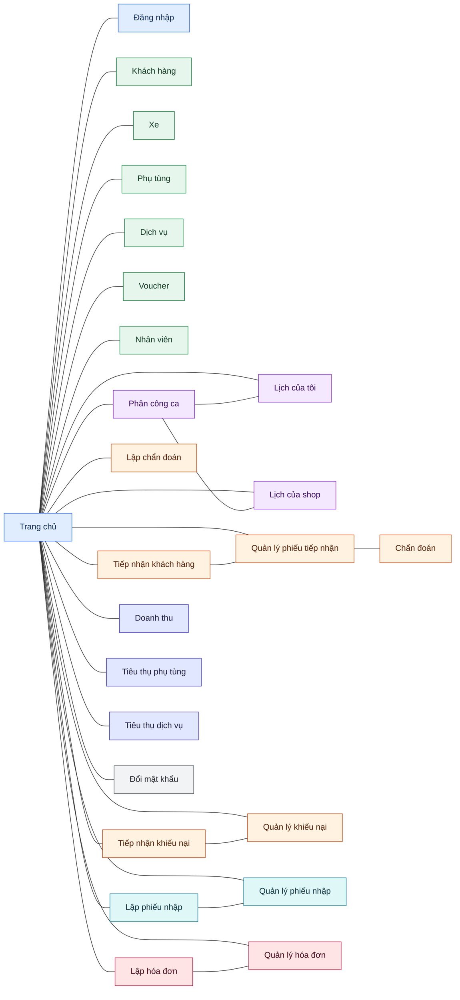

# Garage Ô tô Lúa — Sơ đồ luồng màn hình (Screen Flow)

Tài liệu mô tả **luồng điều hướng và quan hệ giữa các màn hình** của mockup.
Nguồn đối chiếu: `partials/menubar.html` (điều hướng menu), liên kết trong trang
và đặc tả trong skill `code-conversion`.

## Chú giải

- **Hướng:** `LR` (trái → phải), bắt đầu từ entry point **Trang chủ**.
- **Mỗi page là một box chữ nhật duy nhất**, chỉ hiển thị **tên page**; màu nền thể
  hiện **nhóm menu**:

| Nhóm menu | Màn hình (theo tên) | Màu |
|---|---|---|
| Trang chủ & Xác thực | Trang chủ, Đăng nhập | Xanh dương |
| Tổ chức | Khách hàng, Xe, Phụ tùng, Dịch vụ, Voucher, Nhân viên | Xanh lá |
| Kế hoạch | Phân công ca, Lịch của tôi, Lịch của shop | Tím |
| Tiếp nhận | Tiếp nhận khách hàng, Quản lý phiếu tiếp nhận, Lập chẩn đoán, Chẩn đoán, Tiếp nhận khiếu nại, Quản lý khiếu nại | Cam |
| Nhập phụ tùng | Lập phiếu nhập, Quản lý phiếu nhập | Xanh ngọc |
| Thanh toán | Lập hóa đơn, Quản lý hóa đơn | Đỏ hồng |
| Tổng kết | Doanh thu, Tiêu thụ phụ tùng, Tiêu thụ dịch vụ | Chàm |
| Cài đặt | Đổi mật khẩu | Xám |

- **Đường nối:** tất cả là **line liền, không mũi tên, không nhãn** (`---`), biểu diễn
  quan hệ giữa hai page (điều hướng từ Trang chủ tới các màn hình, và các cặp
  thao tác ↔ quản lý).
- Màn hình **Chẩn đoán** là màn hình ẩn, chỉ liên kết với **Quản lý phiếu tiếp nhận**,
  không xuất hiện trong menubar.

## Sơ đồ

