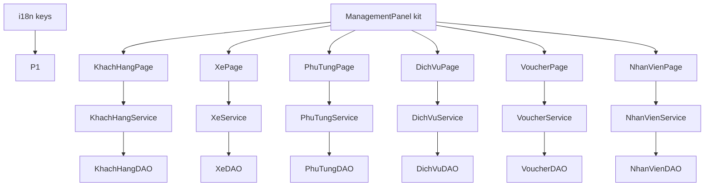

# P1 — L1 Tổ chức (Dữ liệu nền) Implementation Plan

## Goal
6 trang quản lý dữ liệu nền (Khách hàng, Xe, Phụ tùng, Dịch vụ, Voucher, Nhân viên) chạy full-stack `GUI → SERVICE → DAO`, và trở thành lớp service nền cho P2/P3/P4.

## Người phụ trách
- **Lane:** L1 — Tổ chức (Dữ liệu nền)
- **Người làm:** Nguyễn Minh Quốc (`24681861`, thư ký)
- **Nhánh:** `feat/p1-to-chuc` (tách từ `develop`, tạo bằng `git switch -c`)
- **Review/Hỗ trợ:** Mai Thế Hào (`24681001`, nhóm trưởng) — duyệt contract service cho P2/P3/P4

## Scope
- In: 6 page thay `PlaceholderPage` bằng `ManagementPanel` + list thật + form Thêm/Lưu/Xóa Trắng; 6 service; CRUD ở 6 DAO; key i18n cho 6 màn.
- Out: đặt lại mật khẩu (row action), cảnh báo tồn ≤5, filter mọi cột theo cột, ảnh/upload, phân quyền menu, EN dịch đầy đủ.

## Architecture
Mỗi page `extends AbstractPage`, `render()` dựng `ManagementPanel` (kit dùng chung đã có bộ lọc theo cột + điều hướng phân trang), gọi `service.search(criteria)` trả `PaginatedResult` để đổ bảng; nút Thêm/Lưu/Xóa Trắng gọi service; service lọc (bỏ dấu) + phân trang + validate + sinh mã rồi gọi DAO; DAO chỉ CRUD/row-mapping.

## Assumptions
- (assumption) kit dùng chung `ManagementPanel` và `EnumLabels` đã có sẵn; các lane gọi service ở tầng GUI, không JDBC.
- (assumption) Bảng trong DB đã có dữ liệu seed (`mock.sql`); mã sinh qua `MaGeneratorUtil`.
- (assumption) Mật khẩu lưu plaintext như `NhanVienDAO` hiện tại (không đổi trong tuần này).

## User Review Required
> [!IMPORTANT]
> `KhachHangService`/`XeService`/`PhuTungService`/`DichVuService`/`VoucherService`/`NhanVienService` là **contract liên lane**: P2 dùng KhachHang/Xe/NhanVien, P3 dùng PhuTung/DichVu/Voucher, P4 dùng NhanVien. Chốt chữ ký trong plan này trước khi P2/P3/P4 bắt đầu.

## Open Questions
None

## AffectedFiles
| File | Action | Why |
| :--- | :--- | :--- |
| `src/resources/i18n_vn.json` | MODIFY | Key `app.khachHang/xe/phuTung/dichVu/voucher/nhanVien.*` |
| `src/resources/i18n_en.json` | MODIFY | Parity key EN |
| `src/iuh/fit/service/KhachHangService.java` | NEW | Nghiệp vụ + sinh mã khách hàng |
| `src/iuh/fit/dao/KhachHangDAO.java` | MODIFY | Thêm insert/update/delete |
| `src/iuh/fit/gui/page/KhachHangPage.java` | MODIFY | Màn quản lý khách hàng |
| `src/iuh/fit/dto/PaginatedResult.java` | NEW | DTO kết quả phân trang dùng chung (`items/page/pageSize/totalItems` + instance `totalPages/hasNext/hasPrevious/fromIndex/toIndex` + static `DEFAULT_PAGE_SIZE/of/totalPages/clampPage`) |
| `src/iuh/fit/dto/DanhSachKhachHangCriteria.java` | NEW | Tiêu chí lọc (mã/SĐT/họ tên/ngày tạo/tìm nhanh) + `page/pageSize` |
| `src/iuh/fit/gui/component/ManagementPanel.java` | MODIFY | Bổ sung bộ lọc theo cột + tìm nhanh + điều hướng phân trang + khoảng ngày bằng LGoodDatePicker (mở rộng kit dùng chung) |
| `src/iuh/fit/service/XeService.java` | NEW | Nghiệp vụ xe |
| `src/iuh/fit/dao/XeDAO.java` | MODIFY | Thêm insert/update/delete |
| `src/iuh/fit/gui/page/XePage.java` | MODIFY | Màn quản lý xe |
| `src/iuh/fit/service/PhuTungService.java` | NEW | Nghiệp vụ phụ tùng |
| `src/iuh/fit/dao/PhuTungDAO.java` | MODIFY | Thêm insert/update/delete |
| `src/iuh/fit/gui/page/PhuTungPage.java` | MODIFY | Màn quản lý phụ tùng |
| `src/iuh/fit/service/DichVuService.java` | NEW | Nghiệp vụ dịch vụ |
| `src/iuh/fit/dao/DichVuDAO.java` | MODIFY | Thêm insert/update/delete |
| `src/iuh/fit/gui/page/DichVuPage.java` | MODIFY | Màn bảng giá dịch vụ |
| `src/iuh/fit/service/VoucherService.java` | NEW | Nghiệp vụ voucher |
| `src/iuh/fit/dao/VoucherDAO.java` | MODIFY | Thêm insert/update/delete |
| `src/iuh/fit/gui/page/VoucherPage.java` | MODIFY | Màn quản lý voucher |
| `src/iuh/fit/service/NhanVienService.java` | NEW | Liệt kê/thêm/sửa/xóa nhân viên |
| `src/iuh/fit/dao/NhanVienDAO.java` | MODIFY | Thêm delete |
| `src/iuh/fit/gui/page/NhanVienPage.java` | MODIFY | Màn tài khoản & phân quyền |

## Constraints
- GUI không gọi DAO/JDBC; service không gọi JDBC trực tiếp; DAO không lọc/sắp xếp/aggregate nghiệp vụ.
- Chữ ký service (contract liên lane) giữ nguyên như Spec dưới; không đổi tên tham số/kiểu trả về.
- Không comment method; class comment tiếng Việt ngắn; dùng `this.`.
- Enum hiển thị qua `EnumLabels.text(...)`, không hiện code thô.

## Conventions
- Page `extends AbstractPage`; `render()` `removeAll()` → dựng panel → `add` → `revalidate()/repaint()`.
- DAO: `findAll()` trả `List<T>`, `findById(...)` trả **`Optional<T>`** + `insert(T)`, `update(T)`, `delete(String id)`; service (tên method tiếng Anh, **ném exception không trả `null`**): `search(criteria)` trả `PaginatedResult<T>` (lọc bỏ dấu ở service; phân trang do `PaginatedResult.of`), `create(T)`, `update(T)`, `delete(String)`.
- Bảng hiển thị mã/cột tiếng Việt qua header i18n; nút theo style kit dùng chung.

## TaskUnits

### U1: i18n cho 6 màn
- **Files:** `src/resources/i18n_vn.json`, `src/resources/i18n_en.json`
- **DependsOn:** none
- **Spec:**
  - [ ] **Step 1:** `src/resources/i18n_vn.json` - thêm nhóm `app.khachHang` (`title="Quản lý khách hàng"`, `ma="Mã KH"`, `sdt="SĐT"`, `hoTen="Họ tên"`, `ngayTao="Ngày tạo"`); `app.xe` (`title`, `bienSo="Biển số"`, `hangXe="Hãng"`, `dongXe="Dòng"`, `doiXe="Đời"`, `odo="ODO"`).
  - [ ] **Step 2:** thêm `app.phuTung` (`title`, `ma="Mã phụ tùng"`, `ten="Tên phụ tùng"`, `donGiaNhap="Đơn giá nhập"`, `soLuongTon="Tồn"`); `app.dichVu` (`title`, `ma`, `ten`, `donGia="Đơn giá"`).
  - [ ] **Step 3:** thêm `app.voucher` (`title`, `ma`, `ten="Tên chương trình"`, `mucGiam="Mức giảm"`, `thoiHan="Thời hạn"`, `kichHoat="Kích hoạt"`); `app.nhanVien` (`title`, `ma`, `hoTen`, `sdt`, `vaiTro="Vai trò"`, `trangThai="Trạng thái"`).
  - [ ] **Step 4:** `src/resources/i18n_en.json` - thêm đủ key tương ứng (EN).
  - [ ] **Step 5:** kiểm tra parity, xác nhận PASS.
- **Verify:** chạy đoạn python parity (xem README → "Kiểm tra parity i18n") -> `PARITY_OK`.

### U2: Khách hàng + Xe
- **Files:** `src/iuh/fit/service/KhachHangService.java`, `src/iuh/fit/dao/KhachHangDAO.java`, `src/iuh/fit/gui/page/KhachHangPage.java`, `src/iuh/fit/service/XeService.java`, `src/iuh/fit/dao/XeDAO.java`, `src/iuh/fit/gui/page/XePage.java`
- **DependsOn:** U1
- **Spec:**
  - [ ] **Step 1:** `KhachHangDAO.java` - thêm `public void insert(KhachHang k)`, `public void update(KhachHang k)`, `public void delete(String maKhachHang)` (PreparedStatement, `ngayTao` set `LocalDateTime.now()` khi insert).
  - [ ] **Step 2:** `KhachHangService.java` (NEW) - `private final KhachHangDAO khachHangDAO = new KhachHangDAO();`; `public PaginatedResult<KhachHang> search(DanhSachKhachHangCriteria criteria) throws SQLException` (lấy raw từ `findAll()`, lọc theo mã/SĐT/họ tên chứa-bỏ-dấu + khoảng ngày tạo + `timNhanh`, rồi trả `PaginatedResult.of(matched, page, pageSize)` — **service chỉ lọc, phần tính `totalPages`/kẹp trang/cắt dòng do `PaginatedResult` lo** (`DEFAULT_PAGE_SIZE = 10` đặt trong `PaginatedResult`)); `public void create(KhachHang customer) throws SQLException` (validate `sdt` khớp `\d{10}` và `hoTen` không rỗng, ngược lại ném `IllegalArgumentException`; sinh mã qua `MaGeneratorUtil.sinhMa("KH", 3, danhSachMa)` (khớp định dạng seed `KH001..` trong DB, không dùng 8 chữ số) rồi `insert`); `public void update(KhachHang customer)`; `public void delete(String maKhachHang)`.
  - [ ] **Step 3:** `KhachHangPage.java` (MODIFY) - bỏ `extends PlaceholderPage`, `extends AbstractPage`; `getTitleKey()` trả `"app.menu.customers"`, `getGroup()` trả `MenuGroup.TO_CHUC`; `render()` dựng `ManagementPanel`, `setHeaders` (`app.khachHang.ma`, `.sdt`, `.hoTen`, `.ngayTao`), thêm 3 ô lọc text theo cột + 1 khoảng ngày cho cột Ngày tạo (LGoodDatePicker), gắn `setFilterChangeListener` (đổi lọc → tải trang 1) và nút `‹ Trước`/`Sau ›`; nạp `search(criteria)` (bắt `SQLException` → `JOptionPane` i18n lỗi hệ thống) rồi `setRows`/`setCount`/`setPage`; gắn listener Thêm/Lưu/Xóa Trắng đọc form 4 field.
  - [ ] **Step 4:** lặp lại Step 1-3 cho Xe: `XeDAO.insert/update/delete`, `XeService.search/create/update/delete` (khóa tự nhiên `bienSo`, không sinh mã), `XePage` header `app.xe.*`, `getGroup()` `TO_CHUC`, title `app.menu.vehicles`.
  - [ ] **Step 5:** build + chạy, xác nhận PASS.
- **Verify:** `javac -cp "lib/*" -d bin $(find src -name '*.java') && cp -r src/resources bin/ && echo BUILD_OK` -> `BUILD_OK`; `timeout 8 java -cp "bin:lib/*" iuh.fit.Main` -> không stacktrace; mở menu `Tổ chức → Khách hàng` thấy danh sách seed; thêm 1 KH mới → hàng mới xuất hiện.

### U3: Phụ tùng + Dịch vụ
- **Files:** `src/iuh/fit/service/PhuTungService.java`, `src/iuh/fit/dao/PhuTungDAO.java`, `src/iuh/fit/gui/page/PhuTungPage.java`, `src/iuh/fit/service/DichVuService.java`, `src/iuh/fit/dao/DichVuDAO.java`, `src/iuh/fit/gui/page/DichVuPage.java`
- **DependsOn:** U1
- **Spec:**
  - [ ] **Step 1:** `PhuTungDAO.java` - thêm `insert/update/delete`; thêm `public void increaseStock(String maPhuTung, int soLuong)` (UPDATE `soLuongTon = soLuongTon + ?`) phục vụ P3.
  - [ ] **Step 2:** `PhuTungService.java` (NEW) - `search()/create()/update()/delete()`; `create` sinh mã `MaGeneratorUtil.sinhMa("PT", 8, dsMa)`, validate `donGiaNhap >= 0`, `soLuongTon >= 0`.
  - [ ] **Step 3:** `PhuTungPage.java` (MODIFY) - như U2 Step 3, header `app.phuTung.*`, title `app.menu.inventory`, group `TO_CHUC`.
  - [ ] **Step 4:** `DichVuDAO` + `DichVuService` + `DichVuPage` - cùng mẫu; sinh mã `DV`; header `app.dichVu.*`; title `app.menu.servicePriceList`.
  - [ ] **Step 5:** build + chạy, xác nhận PASS.
- **Verify:** `javac ... && cp -r src/resources bin/ && echo BUILD_OK` -> `BUILD_OK`; mở `Dịch vụ` và `Phụ tùng` thấy dữ liệu; sửa 1 dòng → lưu → reload còn giá trị mới.

### U4: Voucher + Nhân viên
- **Files:** `src/iuh/fit/service/VoucherService.java`, `src/iuh/fit/dao/VoucherDAO.java`, `src/iuh/fit/gui/page/VoucherPage.java`, `src/iuh/fit/service/NhanVienService.java`, `src/iuh/fit/dao/NhanVienDAO.java`, `src/iuh/fit/gui/page/NhanVienPage.java`
- **DependsOn:** U1
- **Spec:**
  - [ ] **Step 1:** `VoucherDAO.java` - thêm `insert/update/delete`; `VoucherService.java` (NEW) - `search()/create()/update()/delete()`; validate `mucGiam` trong `(0,1]`; `trangThaiKichHoat` theo checkbox.
  - [ ] **Step 2:** `VoucherPage.java` (MODIFY) - header `app.voucher.*`, title `app.menu.vouchers`, group `TO_CHUC`.
  - [ ] **Step 3:** `NhanVienDAO.java` - thêm `public void delete(String maNhanVien)`.
  - [ ] **Step 4:** `NhanVienService.java` (NEW) - `search()/create(NhanVien)/update(NhanVien)/delete(String)`; `create` sinh mã `MaGeneratorUtil.genMaNhanVien(soDienThoai)`, set `ngayTao`; vai trò/trạng thái nhập là enum, hiển thị qua `EnumLabels.text(...)`.
  - [ ] **Step 5:** `NhanVienPage.java` (MODIFY) - header `app.nhanVien.*`, title `app.menu.employees`, group `TO_CHUC`, cột vai trò/trạng thái dùng `EnumLabels`.
  - [ ] **Step 6:** build + chạy, xác nhận PASS.
- **Verify:** `javac ... && echo BUILD_OK` -> `BUILD_OK`; mở `Nhân viên` thấy danh sách, cột vai trò/trạng thái hiển thị tiếng Việt (không hiện `NHAN_VIEN_*` thô); thêm 1 nhân viên mới thành công.

## Acceptance
- [ ] 6 màn mở từ menu đúng nhóm `Tổ chức`, hiển thị dữ liệu thật từ DB (không còn Placeholder).
- [ ] Thêm/Lưu/Xóa Trắng trên mỗi màn thay đổi DB và reload đúng.
- [ ] Vai trò/trạng thái nhân viên hiển thị nhãn tiếng Việt qua `EnumLabels`; không lộ code thô.
- [ ] Mã mới sinh đúng tiền tố (`KH`/`PT`/`DV`…) và không trùng.
- [ ] Build `javac` toàn bộ `src` không lỗi; app chạy không stacktrace.

## Risks
- (note) `NhanVienDAO`/`AuthService` đã có logic `register`/`updatePassword`; `NhanVienService.create` có thể trùng lặp nhẹ — chấp nhận trong tuần, không refactor `AuthService`.
- (note) V2 `soDienThoai` phải được apply trước khi `NhanVienPage` chạy; nếu thiếu, xử lý ở bước verify DB của lane.
- (note) `i18n_vn/en.json` là file dùng chung mọi lane — chỉ thêm nhóm key của mình, không sửa/xóa key lane khác.
