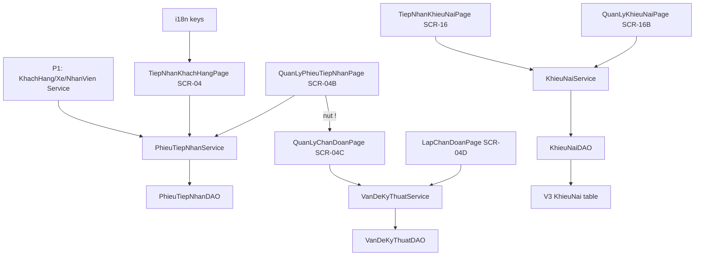

# P2 — L2 Tiếp nhận & Khiếu nại Implementation Plan

## Goal
Hoàn thiện trọn luồng tiếp nhận xe → quản lý phiếu → xem/lập chẩn đoán kỹ thuật, và tiếp nhận/quản lý khiếu nại, chạy full-stack `GUI → SERVICE → DAO`.

## Người phụ trách
- **Lane:** L2 — Tiếp nhận & Khiếu nại
- **Người làm:** Trần Nguyễn Hữu Thắng (`24675701`)
- **Nhánh:** `feat/p2-tiep-nhan-khieu-nai` (tách từ `develop`, tạo bằng `git switch -c`)
- **Review/Hỗ trợ:** Mai Thế Hào (`24681001`, nhóm trưởng) — duyệt contract với P1/P3 và `PageRegistry`.

## Scope
- In: SCR-04, SCR-04B, SCR-04C (màn mới, ẩn), SCR-04D, SCR-16, SCR-16B; service `PhieuTiepNhan/VanDeKyThuat/KhieuNai`; DAO `VanDeKyThuat/KhieuNai`; entity `KhieuNai` + enum `TrangThaiKhieuNai`; migration bảng `KhieuNai`; key i18n.
- Out: badge màu ngữ nghĩa, filter đầy đủ mọi cột, view-switch có animation, validation sâu, EN dịch đầy đủ, đính kèm ảnh.

## Architecture
Page `extends AbstractPage`, dùng `ManagementPanel` (kit dùng chung); SCR-04/04D là form nghiệp vụ riêng. Service điều phối, DAO chỉ CRUD/row-mapping. SCR-04C ẩn, chỉ mở từ hành động `!` ở SCR-04B.

## Assumptions
- (assumption) kit dùng chung (`ManagementPanel`, `EnumLabels`) và P1 (`KhachHangService`, `XeService`, `NhanVienService`) đã có trước khi lane này bắt đầu.
- (assumption) `PhieuTiepNhan` dùng `trangThai` (không phải `trangThaiPhieuTiepNhan`) và enum thật `TIEP_NHAN/DANG_XU_LY/HOAN_THANH/DA_HUY`.
- (assumption) `VanDeKyThuat` dùng `maVanDe` (spec mockup ghi `maVanDeKyThuat`); `khachHangDongY` là enum `CO/KHONG/CHUA_XAC_NHAN`.

## User Review Required
> [!IMPORTANT]
> 1) Bảng `KhieuNai` **chưa tồn tại** trong `init.sql`/`V0` → plan tạo migration `V3__add_khieu_nai.sql`.
> 2) Thêm class mới `QuanLyChanDoanPage` (SCR-04C) và đăng ký trong `src/iuh/fit/gui/page/PageRegistry.java` (file dùng chung — chỉ thêm 1 dòng).
> 3) `V0__init_database.sql` có dấu phẩy thừa trước `);` ở `VanDeKyThuat` — phải xác nhận container DB có bảng này trước khi viết `VanDeKyThuatDAO`.

## Open Questions
None

## AffectedFiles
| File | Action | Why |
| :--- | :--- | :--- |
| `src/resources/i18n_vn.json` | MODIFY | Key `app.tiepNhan/chanDoan/khieuNai.*` + enum |
| `src/resources/i18n_en.json` | MODIFY | Parity key EN |
| `infra/migrations/V3__add_khieu_nai.sql` | NEW | Tạo bảng `KhieuNai` |
| `src/iuh/fit/entity/KhieuNai.java` | NEW | POJO khiếu nại |
| `src/iuh/fit/enumeration/TrangThaiKhieuNai.java` | NEW | `CHUA_XU_LY/DANG_XU_LY/DA_XU_LY` |
| `src/iuh/fit/dao/KhieuNaiDAO.java` | NEW | CRUD khiếu nại |
| `src/iuh/fit/service/KhieuNaiService.java` | NEW | Nghiệp vụ khiếu nại |
| `src/iuh/fit/dao/VanDeKyThuatDAO.java` | NEW | CRUD chẩn đoán |
| `src/iuh/fit/service/VanDeKyThuatService.java` | NEW | Nghiệp vụ chẩn đoán |
| `src/iuh/fit/dao/PhieuTiepNhanDAO.java` | MODIFY | Thêm insert/update |
| `src/iuh/fit/service/PhieuTiepNhanService.java` | NEW | Nghiệp vụ phiếu tiếp nhận |
| `src/iuh/fit/gui/page/TiepNhanKhachHangPage.java` | MODIFY | SCR-04 |
| `src/iuh/fit/gui/page/QuanLyPhieuTiepNhanPage.java` | MODIFY | SCR-04B |
| `src/iuh/fit/gui/page/QuanLyChanDoanPage.java` | NEW | SCR-04C (ẩn) |
| `src/iuh/fit/gui/page/PageRegistry.java` | MODIFY | Đăng ký `QuanLyChanDoanPage` |
| `src/iuh/fit/gui/page/LapChanDoanPage.java` | MODIFY | SCR-04D |
| `src/iuh/fit/gui/page/TiepNhanKhieuNaiPage.java` | MODIFY | SCR-16 |
| `src/iuh/fit/gui/page/QuanLyKhieuNaiPage.java` | MODIFY | SCR-16B |

## Constraints
- Phụ thuộc contract P1: `KhachHangService.search(...)`, `XeService.search(...)`; không tự viết lại logic tra cứu KH/Xe.
- GUI không gọi DAO/JDBC; service không gọi JDBC trực tiếp; DAO không lọc/aggregate nghiệp vụ.
- Không comment method; class comment tiếng Việt ngắn; dùng `this.`.
- Chỉ được đụng `PageRegistry.java` và `i18n_*.json` (file dùng chung) trong phạm vi thêm mới; không sửa phần của lane khác.
- SCR-04C không được xuất hiện trong menubar: `getGroup()` trả `null`.

## Conventions
- Page `extends AbstractPage`; `getTitleKey()` dùng `app.menu.*`; `render()` `removeAll()` → dựng → `revalidate()/repaint()`.
- DAO verb: `findAll/insert/update/delete`, `findById` trả `Optional<T>`; service (tên tiếng Anh, ném exception không trả `null`): `search/create/update/delete`.
- Sinh mã qua `MaGeneratorUtil.sinhMa(tienTo, soChuSo, dsMaHienCo)`.

## TaskUnits

### U1: i18n + enum key
- **Files:** `src/resources/i18n_vn.json`, `src/resources/i18n_en.json`
- **DependsOn:** none
- **Spec:**
  - [ ] **Step 1:** `src/resources/i18n_vn.json` - thêm `app.tiepNhan` (`title`, `maPhieu="Mã phiếu"`, `khachHang="Khách hàng"`, `bienSo="Biển số"`, `moTa="Mô tả tình trạng"`, `trangThai="Trạng thái"`, `luu="Lưu Phiếu Tiếp Nhận"`, `lamMoi="Làm Mới"`).
  - [ ] **Step 2:** thêm `app.chanDoan` (`title`, `ma="Mã vấn đề"`, `tieuDe="Tiêu đề"`, `moTa="Mô tả"`, `uuTien="Ưu tiên"`, `dongY="Khách hàng đồng ý"`, `giaiPhap="Giải pháp"`, `chuaXacNhan="Chưa xác nhận"`); `app.khieuNai` (`title`, `ma="Mã khiếu nại"`, `khachHang`, `maPhieu="Phiếu tiếp nhận"`, `noiDung="Nội dung"`, `trangThai`, `ngayTao`).
  - [ ] **Step 3:** thêm `app.enum.TrangThaiKhieuNai` (`CHUA_XU_LY="Chưa xử lý"`, `DANG_XU_LY="Đang xử lý"`, `DA_XU_LY="Đã xử lý"`).
  - [ ] **Step 4:** `src/resources/i18n_en.json` - thêm đủ key tương ứng (EN).
  - [ ] **Step 5:** kiểm tra parity, xác nhận PASS.
- **Verify:** chạy đoạn python parity (xem README → "Kiểm tra parity i18n") -> `PARITY_OK`.

### U2: Domain Khiếu nại (bảng mới)
- **Files:** `infra/migrations/V3__add_khieu_nai.sql`, `src/iuh/fit/entity/KhieuNai.java`, `src/iuh/fit/enumeration/TrangThaiKhieuNai.java`, `src/iuh/fit/dao/KhieuNaiDAO.java`, `src/iuh/fit/service/KhieuNaiService.java`
- **DependsOn:** U1
- **Spec:**
  - [ ] **Step 1:** `V3__add_khieu_nai.sql` (NEW) - `CREATE TABLE KhieuNai (maKhieuNai varchar(20) PK, maKhachHang varchar(20) FK KhachHang, maPhieuTiepNhan varchar(20) FK PhieuTiepNhan, noiDung nvarchar(max) NOT NULL, trangThai varchar(50) NOT NULL, ngayTao datetime2(3) DEFAULT sysdatetime() NOT NULL)`.
  - [ ] **Step 2:** `TrangThaiKhieuNai.java` (NEW) - `public enum TrangThaiKhieuNai { CHUA_XU_LY, DANG_XU_LY, DA_XU_LY }`.
  - [ ] **Step 3:** `KhieuNai.java` (NEW) - POJO: `maKhieuNai, maKhachHang, maPhieuTiepNhan, noiDung, TrangThaiKhieuNai trangThai, LocalDateTime ngayTao`; constructor rỗng + full + getter/setter.
  - [ ] **Step 4:** `KhieuNaiDAO.java` (NEW) - `extends BaseDao<KhieuNai>`; `SQL_SELECT`, `findById`, `findAll`, `insert/update/delete`, `mapRow`.
  - [ ] **Step 5:** `KhieuNaiService.java` (NEW) - `search()/create(KhieuNai)/update(KhieuNai)/delete(String)`; `create` sinh mã `MaGeneratorUtil.sinhMa("KN", 8, dsMa)`, set `ngayTao`, mặc định `CHUA_XU_LY`.
  - [ ] **Step 6:** build + apply migration lên container, xác nhận PASS.
- **Verify:** `javac -cp "lib/*" -d bin $(find src -name '*.java') && echo BUILD_OK` -> `BUILD_OK`; `grep -c "CREATE TABLE KhieuNai" infra/migrations/V3__add_khieu_nai.sql` -> `1`; chạy `KhieuNaiService.search(...)` qua jshell (có DB) -> không lỗi.

### U3: Phiếu tiếp nhận + Chẩn đoán (domain) + SCR-04
- **Files:** `src/iuh/fit/dao/PhieuTiepNhanDAO.java`, `src/iuh/fit/service/PhieuTiepNhanService.java`, `src/iuh/fit/dao/VanDeKyThuatDAO.java`, `src/iuh/fit/service/VanDeKyThuatService.java`, `src/iuh/fit/gui/page/TiepNhanKhachHangPage.java`
- **DependsOn:** U1
- **Spec:**
  - [ ] **Step 1:** `PhieuTiepNhanDAO.java` - thêm `public void insert(PhieuTiepNhan p)` và `public void update(PhieuTiepNhan p)` (set `ngayTao` khi insert).
  - [ ] **Step 2:** `PhieuTiepNhanService.java` (NEW) - `search(...)`, `searchByCustomerOrPlate(String)` (lọc in-memory, không lọc ở DAO), `create(PhieuTiepNhan)` (validate FK tồn tại qua P1 service, sinh mã `PTN`, trạng thái mặc định `TIEP_NHAN`).
  - [ ] **Step 3:** `VanDeKyThuatDAO.java` (NEW) - `findByPhieuTiepNhan(String)`, `insert(VanDeKyThuat)`, `update(VanDeKyThuat)`, `mapRow`.
  - [ ] **Step 4:** `VanDeKyThuatService.java` (NEW) - `listBySlip(String)`, `create(VanDeKyThuat)` (validate `mucDoUuTien` 1-100, `tieuDe` không rỗng, sinh mã `VD`); `khachHangDongY == null` coi là `CHUA_XAC_NHAN`.
  - [ ] **Step 5:** `TiepNhanKhachHangPage.java` (MODIFY) - SCR-04: bỏ Placeholder; 2 nhóm `Thông Tin Khách Hàng` / `Phương Tiện`; tra KH theo SĐT (dùng `KhachHangService`), tra xe theo biển số (`XeService`); nút `Làm Mới` + `Lưu Phiếu Tiếp Nhận`; lưu qua `PhieuTiepNhanService.them`.
  - [ ] **Step 6:** build + chạy, xác nhận PASS.
- **Verify:** `javac ... && echo BUILD_OK` -> `BUILD_OK`; mở SCR-04, nhập SĐT có seed (`mock.sql`) → điền KH; chọn biển số → điền xe; bấm Lưu → phiếu mới trong DB (kiểm qua SCR-04B).

### U4: SCR-04B + SCR-04C (màn mới, ẩn)
- **Files:** `src/iuh/fit/gui/page/QuanLyPhieuTiepNhanPage.java`, `src/iuh/fit/gui/page/QuanLyChanDoanPage.java`, `src/iuh/fit/gui/page/PageRegistry.java`
- **DependsOn:** U3
- **Spec:**
  - [ ] **Step 1:** `QuanLyChanDoanPage.java` (NEW) - `extends AbstractPage`; read-only `VanDeKyThuat` của 1 phiếu; `getTitleKey()` `app.chanDoan.title`; `getGroup()` trả `null` (không vào menu); `render()` nhận mã phiếu qua field `setMaPhieuTiepNhan(String)` rồi nạp `VanDeKyThuatService.listBySlip`.
  - [ ] **Step 2:** `PageRegistry.java` - thêm `this.register(new QuanLyChanDoanPage());` sau `LapChanDoanPage` (chỉ 1 dòng).
  - [ ] **Step 3:** `QuanLyPhieuTiepNhanPage.java` (MODIFY) - SCR-04B dùng `ManagementPanel`; header `app.tiepNhan.*`; cột trạng thái dùng `EnumLabels`; cột hành động cuối gồm nút `!` (`triangle-alert`) → `goTo(QuanLyChanDoanPage.class)` sau khi set mã phiếu; không hiện code thô.
  - [ ] **Step 4:** build + chạy, xác nhận PASS.
- **Verify:** `javac ... && echo BUILD_OK` -> `BUILD_OK`; SCR-04B hiển thị danh sách + trạng thái tiếng Việt; bấm `!` → mở SCR-04C; xác nhận SCR-04C **không** có trong menubar (`getGroup()==null`).

### U5: SCR-04D + SCR-16 + SCR-16B
- **Files:** `src/iuh/fit/gui/page/LapChanDoanPage.java`, `src/iuh/fit/gui/page/TiepNhanKhieuNaiPage.java`, `src/iuh/fit/gui/page/QuanLyKhieuNaiPage.java`
- **DependsOn:** U2, U3
- **Spec:**
  - [ ] **Step 1:** `LapChanDoanPage.java` (MODIFY) - SCR-04D master-detail 2 "bước" bằng 2 panel ẩn/hiện (không dùng `js`): bước 1 chọn phiếu (tìm theo mã/biển số/KH + lọc trạng thái); bước 2 ẩn danh sách, hiện danh sách chẩn đoán của phiếu + form thêm; thêm qua `VanDeKyThuatService.them`.
  - [ ] **Step 2:** `TiepNhanKhieuNaiPage.java` (MODIFY) - SCR-16: chọn KH (P1 service), chọn phiếu tiếp nhận, nhập nội dung; lưu qua `KhieuNaiService.them`.
  - [ ] **Step 3:** `QuanLyKhieuNaiPage.java` (MODIFY) - SCR-16B dùng `ManagementPanel`; header `app.khieuNai.*`; cột trạng thái dùng `EnumLabels`; đổi trạng thái qua `update`.
  - [ ] **Step 4:** build + chạy, xác nhận PASS.
- **Verify:** `javac ... && echo BUILD_OK` -> `BUILD_OK`; SCR-04D: chọn phiếu → thêm 1 chẩn đoán → xuất hiện trong danh sách chẩn đoán và ở SCR-04C; SCR-16 lưu 1 khiếu nại → SCR-16B thấy dòng mới + đổi trạng thái được.

## Acceptance
- [ ] SCR-04 lưu phiếu tiếp nhận mới; SCR-04B hiển thị đúng trạng thái (nhãn tiếng Việt, không lộ code).
- [ ] SCR-04C là class mới, mở được từ `!`, **không** xuất hiện trong menubar.
- [ ] SCR-04D lập được chẩn đoán (mã `VD`, ưu tiên 1-100) và thấy lại ở SCR-04C.
- [ ] SCR-16 tạo khiếu nại, SCR-16B đổi trạng thái `CHUA_XU_LY/DANG_XU_LY/DA_XU_LY`.
- [ ] Migration `V3` tạo bảng `KhieuNai` apply thành công; build `javac` không lỗi.

## Risks
- (note) `V0__init_database.sql` dấu phẩy thừa trước `);` tại `VanDeKyThuat` có thể khiến `VanDeKyThuatDAO` fail — phải verify DB trước khi code U3.
- (note) `VanDeKyThuat` mã `VD` + 8 chữ số khác spec mockup (`VD`+YYYYMMDD+4); giữ theo `MaGeneratorUtil` hiện có, ghi nhận để thống nhất sau.
- (note) `PageRegistry` và `i18n_*.json` là file dùng chung mọi lane — chỉ thêm, không sửa của lane khác; xung đột merge do Hào xử lý.
