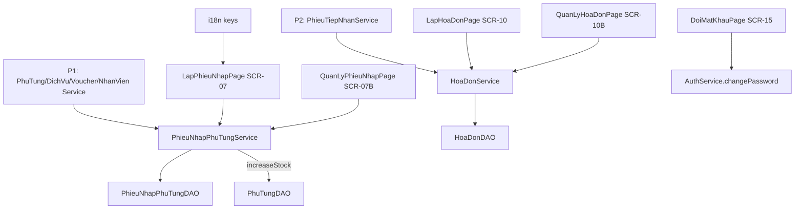

# P3 — L3 Nhập phụ tùng & Thanh toán Implementation Plan

## Goal
Hoàn thiện lập/quản lý phiếu nhập kho phụ tùng (có cộng tồn), lập/quản lý hóa đơn (tính tổng + voucher), và đổi mật khẩu cá nhân, chạy full-stack `GUI → SERVICE → DAO`.

## Người phụ trách
- **Lane:** L3 — Nhập phụ tùng & Thanh toán
- **Người làm:** Nguyễn Trần Trọng Khang (`24677691`)
- **Nhánh:** `feat/p3-nhap-thanh-toan` (tách từ `develop`, tạo bằng `git switch -c`)
- **Review/Hỗ trợ:** Mai Thế Hào (`24681001`, nhóm trưởng) — duyệt contract với P1/P2 và `AuthService`.

## Scope
- In: SCR-07, SCR-07B, SCR-10, SCR-10B, SCR-15; service `PhieuNhapPhuTung/HoaDon`; thêm method chi tiết + ghi DB ở `PhieuNhapPhuTungDAO`/`HoaDonDAO`; cộng tồn phụ tùng; tính tổng + voucher; đổi mật khẩu; key i18n.
- Out: in/xuất Excel, hủy hóa đơn có lý do (UI), giảm giá nâng cao, badge màu, filter đầy đủ mọi cột, EN dịch đầy đủ.

## Architecture
Page `extends AbstractPage` + `ManagementPanel` (kit dùng chung) cho 2 màn danh sách; SCR-07/SCR-10 là form nghiệp vụ riêng. Service tính toán/tổng/hiệu chỉnh tồn; DAO truy cập DB + ghi chi tiết trong cùng transaction.

## Assumptions
- (assumption) kit dùng chung + P1 (`PhuTungService`, `DichVuService`, `VoucherService`, `NhanVienService`, `PhuTungDAO.increaseStock`), P2 (`PhieuTiepNhanService`) đã có trước khi lane bắt đầu.
- (assumption) `HoaDonDAO`/`PhieuNhapPhuTungDAO` đã tự nạp chi tiết (`loadDanhSachChiTiet`), nên ghi chi tiết nằm cùng DAO cha, không tạo DAO chi tiết riêng.
- (assumption) Mật khẩu plaintext như hiện tại; chưa hash trong tuần này.

## User Review Required
> [!IMPORTANT]
> 1) `HoaDonService` và `PhieuNhapPhuTungService` là **contract liên lane** cho P4 (báo cáo) — chốt chữ ký trước khi P4 bắt đầu.
> 2) Sửa `src/iuh/fit/service/AuthService.java` (file lõi dùng chung) để thêm `changePassword(...)`; chỉ P3 đụng file này, cần review của Hào.
> 3) Trạng thái hóa đơn thật là `CHO_THANH_TOAN/DA_THANH_TOAN/DA_HUY` (khác `CHUA_THANH_TOAN` trong mockup).

## Open Questions
None

## AffectedFiles
| File | Action | Why |
| :--- | :--- | :--- |
| `src/resources/i18n_vn.json` | MODIFY | Key `app.phieuNhap/hoaDon/doiMatKhau.*` |
| `src/resources/i18n_en.json` | MODIFY | Parity key EN |
| `src/iuh/fit/dao/PhieuNhapPhuTungDAO.java` | MODIFY | Thêm insert phiếu + chi tiết |
| `src/iuh/fit/service/PhieuNhapPhuTungService.java` | NEW | Nghiệp vụ phiếu nhập + cộng tồn |
| `src/iuh/fit/gui/page/LapPhieuNhapPage.java` | MODIFY | SCR-07 |
| `src/iuh/fit/gui/page/QuanLyPhieuNhapPage.java` | MODIFY | SCR-07B |
| `src/iuh/fit/dao/HoaDonDAO.java` | MODIFY | Thêm insert hóa đơn + chi tiết + update trạng thái |
| `src/iuh/fit/service/HoaDonService.java` | NEW | Nghiệp vụ hóa đơn + tổng tiền |
| `src/iuh/fit/gui/page/LapHoaDonPage.java` | MODIFY | SCR-10 |
| `src/iuh/fit/gui/page/QuanLyHoaDonPage.java` | MODIFY | SCR-10B |
| `src/iuh/fit/service/AuthService.java` | MODIFY | Thêm `changePassword(...)` |
| `src/iuh/fit/gui/page/DoiMatKhauPage.java` | MODIFY | SCR-15 |

## Constraints
- Phụ thuộc contract P1/P2 ở tầng service; không tự viết lại logic tra cứu/tồn.
- GUI không gọi DAO/JDBC; service không gọi JDBC trực tiếp; DAO không tính tổng/aggregate nghiệp vụ.
- Ghi phiếu nhập + chi tiết: dùng **một `Connection`** trong DAO để đảm bảo nhất quán; cộng tồn thực hiện trong cùng transaction.
- Không comment method; class comment tiếng Việt ngắn; dùng `this.`.
- Chỉ thêm mới vào `i18n_*.json`; không sửa key lane khác.

## Conventions
- DAO verb: `findAll/insert/update/delete` (+ `insertChiTiet` nội bộ), `findById` trả `Optional<T>`; service (tên tiếng Anh, ném exception không trả `null`): `search/create/update/delete` và method nghiệp vụ (`createReceipt`, `confirmPayment`).
- Tiền dùng `double`/`Decimal` theo entity hiện có; hiển thị qua `String.format("%,.0f", v)` + đơn vị `đ`.
- Sinh mã: `MaGeneratorUtil.sinhMa("PN", 8, dsMa)` / `sinhMa("HD", 8, dsMa)`.

## TaskUnits

### U1: i18n
- **Files:** `src/resources/i18n_vn.json`, `src/resources/i18n_en.json`
- **DependsOn:** none
- **Spec:**
  - [ ] **Step 1:** `src/resources/i18n_vn.json` - thêm `app.phieuNhap` (`title`, `ma="Mã phiếu"`, `ngayTao="Ngày tạo"`, `moTa="Mô tả lô"`, `phuTung="Phụ tùng"`, `soLuong="Số lượng"`, `donGiaNhap="Đơn giá nhập"`, `thanhTien="Thành tiền"`, `tongChiPhi="Tổng chi phí"`, `luu`).
  - [ ] **Step 2:** thêm `app.hoaDon` (`title`, `ma="Mã hóa đơn"`, `phieuTiepNhan="Phiếu tiếp nhận"`, `voucher="Voucher"`, `khachHang`, `trangThai`, `dichVu="Dịch vụ"`, `phuTung="Phụ tùng"`, `soLuong`, `donGia="Đơn giá"`, `thanhTien`, `tongTien="Tổng tiền"`, `giamGia="Giảm giá"`, `thanhToan="Xác Nhận Thanh Toán"`, `luu="Lưu Hóa Đơn"`, `lamMoi="Làm Mới"`); `app.doiMatKhau` (`title`, `hienTai="Mật khẩu hiện tại"`, `moi="Mật khẩu mới"`, `xacNhan="Xác nhận mật khẩu mới"`, `capNhat="Cập nhật"`, `loiKhongKhop="Mật khẩu xác nhận không khớp."`, `loiSai="Mật khẩu hiện tại không đúng."`).
  - [ ] **Step 3:** `src/resources/i18n_en.json` - thêm đủ key tương ứng (EN).
  - [ ] **Step 4:** kiểm tra parity, xác nhận PASS.
- **Verify:** chạy đoạn python parity (xem README → "Kiểm tra parity i18n") -> `PARITY_OK`.

### U2: Phiếu nhập phụ tùng + SCR-07/07B
- **Files:** `src/iuh/fit/dao/PhieuNhapPhuTungDAO.java`, `src/iuh/fit/service/PhieuNhapPhuTungService.java`, `src/iuh/fit/gui/page/LapPhieuNhapPage.java`, `src/iuh/fit/gui/page/QuanLyPhieuNhapPage.java`
- **DependsOn:** U1
- **Spec:**
  - [ ] **Step 1:** `PhieuNhapPhuTungDAO.java` - thêm `public void insert(PhieuNhapPhuTung p, List<ChiTietPhieuNhapPhuTung> dsChiTiet)`: 1 `Connection`, insert header + từng chi tiết (`maPhieuNhap, maPhuTung, soLuong, donGiaNhap`), `ngayTao = LocalDateTime.now()`; thêm `public List<ChiTietPhieuNhapPhuTung> findChiTiet(String maPhieuNhap)`.
  - [ ] **Step 2:** `PhieuNhapPhuTungService.java` (NEW) - `search(...)`, `createReceipt(String moTa, List<ChiTietPhieuNhapPhuTung> dsChiTiet)`: validate `soLuong > 0`, `donGiaNhap >= 0`, `moTa` không rỗng; sinh mã `PN`; gọi `insert`; **cộng tồn** từng phụ tùng qua `PhuTungDAO.increaseStock(maPhuTung, soLuong)`; trả `PhieuNhapPhuTung`.
  - [ ] **Step 3:** `LapPhieuNhapPage.java` (MODIFY) - SCR-07: `moTa` + bảng dòng chi tiết (chọn phụ tùng từ `PhuTungService`, nhập số lượng/đơn giá nhập) + nút thêm dòng/xóa dòng; hiển thị `Thành Tiền` mỗi dòng và `Tổng Chi Phí`; nút `Lưu`; mã/ngày do hệ thống sinh, không hiển thị input.
  - [ ] **Step 4:** `QuanLyPhieuNhapPage.java` (MODIFY) - SCR-07B dùng `ManagementPanel`, header `app.phieuNhap.*`; nút `Sửa` `goTo(LapPhieuNhapPage.class)`.
  - [ ] **Step 5:** build + chạy, xác nhận PASS.
- **Verify:** `javac -cp "lib/*" -d bin $(find src -name '*.java') && cp -r src/resources bin/ && echo BUILD_OK` -> `BUILD_OK`; lập 1 phiếu nhập 2 dòng → tồn `PhuTung` (xem ở SCR-06) tăng đúng số lượng; SCR-07B thấy phiếu mới.

### U3: Hóa đơn + SCR-10/10B
- **Files:** `src/iuh/fit/dao/HoaDonDAO.java`, `src/iuh/fit/service/HoaDonService.java`, `src/iuh/fit/gui/page/LapHoaDonPage.java`, `src/iuh/fit/gui/page/QuanLyHoaDonPage.java`
- **DependsOn:** U1
- **Spec:**
  - [ ] **Step 1:** `HoaDonDAO.java` - thêm `public void insert(HoaDon h, List<ChiTietHoaDon> dsChiTiet)` (1 `Connection`, header + chi tiết) và `public void updateTrangThai(String maHoaDon, TrangThaiHoaDon trangThai, LocalDateTime thoiGianThanhToan)`; thêm `public HoaDon findByPhieuTiepNhan(String maPhieuTiepNhan)`.
  - [ ] **Step 2:** `HoaDonService.java` (NEW) - `search(...)`, `findBySlip(String)`, `createInvoice(String maPhieuTiepNhan, String maVoucher, List<ChiTietHoaDon> dsChiTiet)`: nếu phiếu đã có hóa đơn thì trả về hóa đơn cũ (1 hóa đơn/phiếu); validate `soLuong > 0`, `donGia >= 0`; sinh mã `HD`; trạng thái `CHO_THANH_TOAN`; `public double calculateTotal(List<ChiTietHoaDon> ds, String maVoucher)` (tổng `soLuong*donGia`, trừ `Voucher.mucGiam` nếu có); `public void confirmPayment(String maHoaDon)`.
  - [ ] **Step 3:** `LapHoaDonPage.java` (MODIFY) - SCR-10 2 cột: trái thông tin hóa đơn (chọn phiếu tiếp nhận, chọn voucher) + khối thanh toán; phải bảng dòng (thêm dịch vụ/phụ tùng, số lượng, đơn giá) + `Tổng Tiền`/`Giảm Giá`; nút `Làm Mới`, `Lưu Hóa Đơn`, `Xác Nhận Thanh Toán`; không hiển thị mã/ngày sinh tự động.
  - [ ] **Step 4:** `QuanLyHoaDonPage.java` (MODIFY) - SCR-10B dùng `ManagementPanel`, header `app.hoaDon.*`, cột trạng thái qua `EnumLabels`; nút `Sửa` `goTo(LapHoaDonPage.class)`.
  - [ ] **Step 5:** build + chạy, xác nhận PASS.
- **Verify:** `javac ... && echo BUILD_OK` -> `BUILD_OK`; chọn 1 phiếu tiếp nhận có seed → thêm 1 dịch vụ + 1 phụ tùng → `Tổng Tiền` đúng (kiểm bằng máy tính tay); Lưu → SCR-10B thấy hóa đơn `Chưa thanh toán`; Xác nhận thanh toán → `Đã thanh toán`.

### U4: Đổi mật khẩu SCR-15
- **Files:** `src/iuh/fit/service/AuthService.java`, `src/iuh/fit/gui/page/DoiMatKhauPage.java`
- **DependsOn:** U1
- **Spec:**
  - [ ] **Step 1:** `AuthService.java` - thêm `public void changePassword(NhanVien nhanVien, String matKhauHienTai, String matKhauMoi, String xacNhanMatKhau) throws SQLException`: kiểm `nhanVien != null`; `matKhauHienTai` khớp `nhanVien.getMatKhau()` (không khớp → ném `PasswordInvalidException`); `matKhauMoi` bằng `xacNhanMatKhau` (không khớp → `PasswordInvalidException`); gọi `this.isValidPassword(matKhauMoi)`; set `nhanVien.setMatKhau(matKhauMoi)` rồi `this.updatePassword(nhanVien)`.
  - [ ] **Step 2:** `DoiMatKhauPage.java` (MODIFY) - SCR-15: 3 `JPasswordField` (`app.doiMatKhau.hienTai/moi/xacNhan`), nút `Cập nhật` gọi `AuthService.changePassword(AppContext.getCurrentUser(), ...)`; lỗi hiện `JOptionPane` i18n; thành công hiện thông báo + xóa field.
  - [ ] **Step 3:** build + chạy, xác nhận PASS.
- **Verify:** `javac ... && echo BUILD_OK` -> `BUILD_OK`; đổi mật khẩu với "mật khẩu mới" yếu (thiếu chữ/số/ký tự đặc biệt) → báo lỗi; nhập đúng → đăng nhập lại bằng mật khẩu mới thành công.

## Acceptance
- [ ] Lập phiếu nhập lưu được và **tồn kho tăng đúng**; SCR-07B hiển thị danh sách phiếu.
- [ ] Lập hóa đơn từ phiếu tiếp nhận, tổng tiền và giảm giá voucher đúng; mỗi phiếu tối đa 1 hóa đơn.
- [ ] `Xác Nhận Thanh Toán` chuyển trạng thái sang `DA_THANH_TOAN`; SCR-10B hiển thị nhãn tiếng Việt.
- [ ] SCR-15 cập nhật mật khẩu có validate hiện tại/khớp/độ mạnh.
- [ ] Không tạo DAO chi tiết riêng; ghi header + chi tiết cùng transaction; build `javac` không lỗi.

## Risks
- (note) Phụ thuộc chéo P1 và P2 — nếu contract chưa có, U2/U3 bị block; ưu tiên ghép cuối ngày 17/10.
- (note) Sửa `AuthService` (file lõi) — giữ thay đổi nhỏ, không refactor method `login/register`.
- (note) `HoaDonDAO`/`PhieuNhapPhuTungDAO` mở nhiều `Connection` nếu tách header/chi tiết; bắt buộc gom 1 connection trong `insert` để tránh dữ liệu nửa vời.
