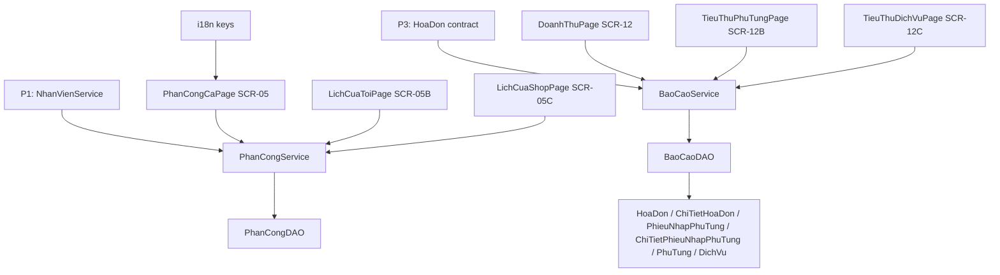

# P4 — L4 Kế hoạch & Tổng kết Implementation Plan

## Goal
Hoàn thiện phân công ca làm việc (gán ca + xem lịch tuần của tôi/của shop) và 3 báo cáo tổng kết (doanh thu, tiêu thụ phụ tùng, tiêu thụ dịch vụ), chạy full-stack `GUI → SERVICE → DAO`.

## Người phụ trách
- **Lane:** L4 — Kế hoạch & Tổng kết
- **Người làm:** Đặng Thanh Bình (`24673191`)
- **Nhánh:** `feat/p4-ke-hoach-tong-ket` (tách từ `develop`, tạo bằng `git switch -c`)
- **Review/Hỗ trợ:** Mai Thế Hào (`24681001`, nhóm trưởng) — duyệt contract báo cáo với P3.

## Scope
- In: SCR-05, SCR-05B, SCR-05C, SCR-12, SCR-12B, SCR-12C; service `PhanCong/BaoCao`; DAO `BaoCaoDAO` (đọc báo cáo) + `PhanCongDAO` (ghi ca); key i18n.
- Out: biểu đồ Java2D, Top 20, lọc kỳ nâng cao (theo khoảng ngày tùy chọn), badge màu, EN dịch đầy đủ.

## Architecture
Page `extends AbstractPage` + `ManagementPanel` (kit dùng chung) cho danh sách. `PhanCongService` kiểm trùng key `(maNhanVien, nam, thang, ngay, caLamViec)`. `BaoCaoService` tổng hợp ở tầng service từ dữ liệu thô do `BaoCaoDAO` trả về (không aggregate nghiệp vụ trong DAO).

## Assumptions
- (assumption) kit dùng chung `ManagementPanel` đã có; P1 đã có `NhanVienService`; P3 đã có bảng hóa đơn + `HoaDonService` trước khi U3 bắt đầu.
- (assumption) `PhanCongDAO` hiện có `findById/findAll`; `PhanCong` gồm `maPhanCong, maNhanVien, ngay, thang, nam, CaLamViec caLamViec, ghiChu`.
- (assumption) Tuần này báo cáo chỉ cần số liệu/bảng; biểu đồ để tuần sau.

## User Review Required
> [!IMPORTANT]
> 1) `BaoCaoService` là điểm chạm với dữ liệu hóa đơn của P3; tuần này tạo `BaoCaoDAO` **riêng** đọc trực tiếp các bảng báo cáo để tránh sửa DAO của P3 (chấp nhận trùng SQL đọc).
> 2) Không có thư viện biểu đồ trong `lib/` → biểu đồ **hoãn** sang tuần sau (nếu làm sẽ là Java2D, không thêm dependency).

## Open Questions
None

## AffectedFiles
| File | Action | Why |
| :--- | :--- | :--- |
| `src/resources/i18n_vn.json` | MODIFY | Key `app.phanCong/lich/baoCaoo.*` + trạng thái |
| `src/resources/i18n_en.json` | MODIFY | Parity key EN |
| `src/iuh/fit/dao/PhanCongDAO.java` | MODIFY | Thêm insert/delete + truy vấn theo tuần |
| `src/iuh/fit/service/PhanCongService.java` | NEW | Nghiệp vụ phân công ca + kiểm trùng |
| `src/iuh/fit/gui/page/PhanCongCaPage.java` | MODIFY | SCR-05 |
| `src/iuh/fit/gui/page/LichCuaToiPage.java` | MODIFY | SCR-05B |
| `src/iuh/fit/gui/page/LichCuaShopPage.java` | MODIFY | SCR-05C |
| `src/iuh/fit/dao/BaoCaoDAO.java` | NEW | Đọc dữ liệu thô cho báo cáo |
| `src/iuh/fit/service/BaoCaoService.java` | NEW | Tổng hợp doanh thu/tiêu thụ |
| `src/iuh/fit/gui/page/DoanhThuPage.java` | MODIFY | SCR-12 |
| `src/iuh/fit/gui/page/TieuThuPhuTungPage.java` | MODIFY | SCR-12B |
| `src/iuh/fit/gui/page/TieuThuDichVuPage.java` | MODIFY | SCR-12C |

## Constraints
- GUI không gọi DAO/JDBC; service không gọi JDBC trực tiếp; DAO **không** group by/tính tổng nghiệp vụ — trả raw rows, service tổng hợp.
- Không thêm dependency/build tool; không có biểu đồ trong tuần này.
- Không comment method; class comment tiếng Việt ngắn; dùng `this.`.
- Chỉ thêm mới vào `i18n_*.json`; không sửa key lane khác.

## Conventions
- DAO verb: `findAll/insert/delete`, `findById` trả `Optional<T>` + `findByWeek(int nam, int thang, int ngayDau)`; service (tên tiếng Anh, ném exception không trả `null`): `search/assignShift/delete` và method báo cáo (`revenueByMonth`, `partsConsumptionByMonth`, `serviceConsumptionByMonth`).
- Ca hiển thị nhãn `Ca sáng/Ca chiều/Ca ngày` qua `EnumLabels`; không badge.
- Lịch tuần: cột Thứ 2 → Chủ nhật; hàng 3 ca.

## TaskUnits

### U1: i18n
- **Files:** `src/resources/i18n_vn.json`, `src/resources/i18n_en.json`
- **DependsOn:** none
- **Spec:**
  - [ ] **Step 1:** `src/resources/i18n_vn.json` - thêm `app.phanCong` (`title`, `nhanVien="Nhân viên"`, `maNhanVien="Mã NV"`, `vaiTro="Vai trò"`, `tuan="Tuần"`, `thu="Thứ"`, `ca="Ca"`, `ghiChu="Ghi chú"`, `ganCa="Gán Ca"`, `trungCa="Nhân viên đã được phân ca này."`).
  - [ ] **Step 2:** thêm `app.lich` (`cuaToi="Lịch của tôi"`, `cuaShop="Lịch của shop"`, `tuanNay="Tuần này"`, `tuanTruoc="‹ Tuần"`, `tuanSau="Tuần ›"`, `tongCa="Tổng ca"`, `tongPhanCong="Tổng phân công"`); `app.baoCaoo` (`doanhThu="Doanh thu"`, `tieuThuPhuTung="Tiêu thụ phụ tùng"`, `tieuThuDichVu="Tiêu thụ dịch vụ"`, `ky="Kỳ"`, `thang="Tháng"`, `nam="Năm"`, `dichVu="Dịch vụ"`, `phuTung="Phụ tùng"`, `soLuong="Số lượng"`, `doanhThuCol="Doanh thu"`, `tongDoanhThu="Tổng doanh thu"`).
  - [ ] **Step 3:** `src/resources/i18n_en.json` - thêm đủ key tương ứng (EN).
  - [ ] **Step 4:** kiểm tra parity, xác nhận PASS.
- **Verify:** chạy đoạn python parity (xem README → "Kiểm tra parity i18n") -> `PARITY_OK`.

### U2: Phân công ca + SCR-05/05B/05C
- **Files:** `src/iuh/fit/dao/PhanCongDAO.java`, `src/iuh/fit/service/PhanCongService.java`, `src/iuh/fit/gui/page/PhanCongCaPage.java`, `src/iuh/fit/gui/page/LichCuaToiPage.java`, `src/iuh/fit/gui/page/LichCuaShopPage.java`
- **DependsOn:** U1
- **Spec:**
  - [ ] **Step 1:** `PhanCongDAO.java` - thêm `public void insert(PhanCong p)`, `public void delete(String maPhanCong)`, `public List<PhanCong> findByTuan(int nam, int thang, int ngayDau, int ngayCuoi)`.
  - [ ] **Step 2:** `PhanCongService.java` (NEW) - `search(...)`, `assignShift(PhanCong p)`: kiểm trùng key `(maNhanVien, nam, thang, ngay, caLamViec)` trong `search(...)` (ném `IllegalStateException` i18n `app.phanCong.trungCa` nếu trùng), sinh mã `PC`, rồi `insert`; `delete(String maPhanCong)`; `listByWeek(int nam, int thang, int ngayDau, int ngayCuoi)`; `listByEmployee(String maNhanVien, ...)`.
  - [ ] **Step 3:** `PhanCongCaPage.java` (MODIFY) - SCR-05: bên trái danh sách nhân viên (từ `NhanVienService`) + tìm theo mã/tên + lọc vai trò; bên phải chọn Tuần/Thứ/Ca (radio) + ghi chú + nút `Gán Ca`; bảng phân công của tuần.
  - [ ] **Step 4:** `LichCuaToiPage.java` (MODIFY) - SCR-05B read-only tuần của nhân viên hiện tại (`AppContext.getCurrentUser()`); cột Thứ 2→Chủ nhật, hàng 3 ca; điều hướng `‹ Tuần / Tuần này / Tuần ›`; tổng số ca.
  - [ ] **Step 5:** `LichCuaShopPage.java` (MODIFY) - SCR-05C read-only lịch toàn shop theo tuần; mỗi ô ca liệt kê nhân viên; tổng phân công.
  - [ ] **Step 6:** build + chạy, xác nhận PASS.
- **Verify:** `javac -cp "lib/*" -d bin $(find src -name '*.java') && cp -r src/resources bin/ && echo BUILD_OK` -> `BUILD_OK`; gán 1 ca → thấy ở lịch tuần; gán lại cùng NV/ngày/ca → hiện cảnh báo trùng; SCR-05B hiện ca của user đang đăng nhập.

### U3: Báo cáo + SCR-12/12B/12C
- **Files:** `src/iuh/fit/dao/BaoCaoDAO.java`, `src/iuh/fit/service/BaoCaoService.java`, `src/iuh/fit/gui/page/DoanhThuPage.java`, `src/iuh/fit/gui/page/TieuThuPhuTungPage.java`, `src/iuh/fit/gui/page/TieuThuDichVuPage.java`
- **DependsOn:** U1
- **Spec:**
  - [ ] **Step 1:** `BaoCaoDAO.java` (NEW) - trả raw rows theo tháng, không aggregate: `findHoaDonTrongThang(int nam, int thang)`, `findChiTietHoaDonTheoLoai(LoaiSanPham, int nam, int thang)`, `findChiTietNhapTrongThang(int nam, int thang)` (map sang các DTO/entity nội bộ hoặc `Object[]` có tên cột).
  - [ ] **Step 2:** `BaoCaoService.java` (NEW) - `doanhThuTheoThang(int nam, int thang)`: tổng `ChiTietHoaDon.soLuong*donGia` cho hóa đơn `DA_THANH_TOAN`, tách phần `DICH_VU`/`PHU_TUNG`; `tieuThuPhuTungTheoThang(...)`: mỗi phụ tùng có Nhập/`PHU_TUNG` Xuất/`soLuongTon`/đơn giá/doanh thu; `tieuThuDichVuTheoThang(...)`: số lần/đơn giá/doanh thu theo dịch vụ.
  - [ ] **Step 3:** `DoanhThuPage.java` (MODIFY) - SCR-12: chọn kỳ (tháng/năm); bảng hóa đơn + tổng doanh thu (dịch vụ vs phụ tùng in số liệu); vùng biểu đồ để trống/ghi chú "hình dung bằng số" (chưa vẽ).
  - [ ] **Step 4:** `TieuThuPhuTungPage.java` (MODIFY) - SCR-12B: bảng theo toàn bộ phụ tùng (chưa cần Top 20) với các cột Nhập/Xuất/Tồn/Đơn giá/Doanh thu.
  - [ ] **Step 5:** `TieuThuDichVuPage.java` (MODIFY) - SCR-12C: bảng theo toàn bộ dịch vụ với số lượng/đơn giá/doanh thu.
  - [ ] **Step 6:** build + chạy, xác nhận PASS.
- **Verify:** `javac ... && echo BUILD_OK` -> `BUILD_OK`; chọn tháng có dữ liệu seed → tổng doanh thu khớp tổng `soLuong*donGia` của hóa đơn `DA_THANH_TOAN` (đối chiếu tay 1-2 dòng); SCR-12B tồn khớp `PhuTung.soLuongTon`.

## Acceptance
- [ ] SCR-05 gán ca thành công; gán trùng `(NV, năm, tháng, ngày, ca)` bị chặn kèm thông báo.
- [ ] SCR-05B hiện lịch tuần của nhân viên đang đăng nhập; SCR-05C hiện lịch toàn shop.
- [ ] SCR-12/12B/12C hiển thị số liệu tháng từ DB; không lộ code enum thô; không thêm dependency.
- [ ] `BaoCaoDAO` chỉ đọc raw, mọi tổng hợp nằm ở `BaoCaoService`.
- [ ] Build `javac` toàn bộ `src` không lỗi; app chạy không stacktrace.

## Risks
- (note) `BaoCaoDAO` đọc trùng bảng với DAO của P3 — chấp nhận trong tuần; có thể gom lại sau khi P3 chốt.
- (note) Không có thư viện biểu đồ → phần biểu đồ SCR-12 để trống có chú thích; không thêm dependency trái quy ước.
- (note) `PhanCong` không có ràng buộc unique ở DB → chống trùng đặt ở `PhanCongService`.
