# DGRAPH — Sơ đồ phụ thuộc Gara Ô tô Lúa (Tuần 1: 14/10 – 19/10)

Tài liệu gom **nhiều góc nhìn phụ thuộc** của kế hoạch tuần 1. Mỗi sơ đồ trả lời một câu hỏi khác nhau.

- **Chú giải trạng thái:** `[DONE]` đã xong · `[TODO]` chưa làm · `[P1..P4]` lane phụ trách.
- Sơ đồ dùng mermaid mặc định (không hardcode màu) để tự tương thích theme sáng/tối của IDE.
- Nguồn: `assets/tasks/2026-10-14-p1..p4-*.md`, `assets/mockui/docs/screen-flow.md`, `src/iuh/fit/**`, `init.sql`.

---

## 1. Phụ thuộc giữa các plan (lane)

Góc nhìn: **lane nào chặn lane nào**. Kit dùng chung (Wave 0) đã xong nên không còn chặn lane; P1 là nền dữ liệu; P3 cần P2; P4 cần P3.

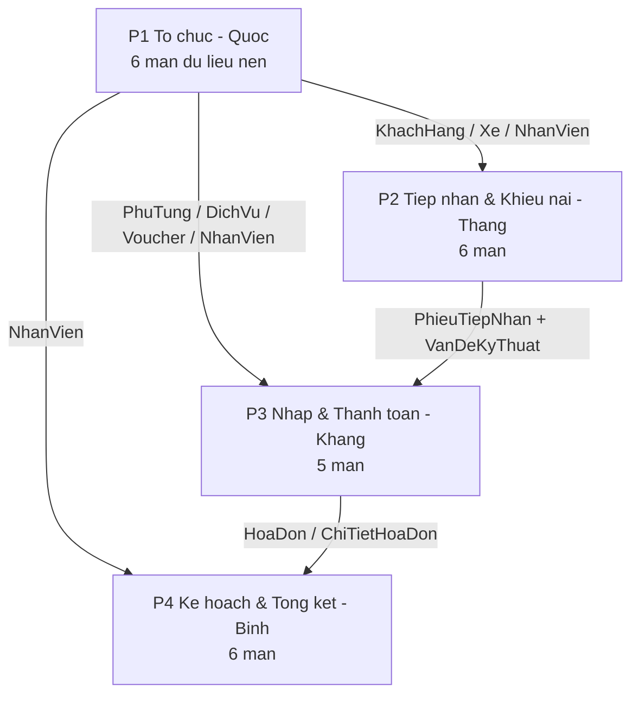

---

## 2. Contract service liên lane (ai cấp, ai tiêu thụ)

Góc nhìn: **điểm chạm chéo lane cần chốt chữ ký sớm** để không bị block.

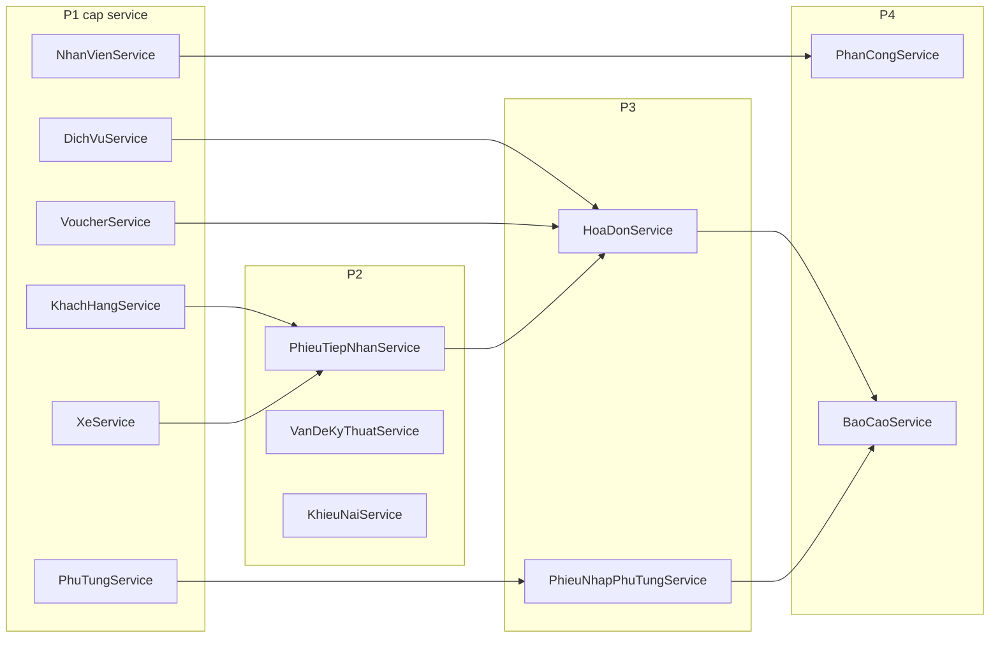

---

## 3. Kiến trúc 3 tầng (GUI → SERVICE → DAO → DB)

Góc nhìn: **chiều phụ thuộc bắt buộc** theo code-convention; entity là POJO dùng chung.

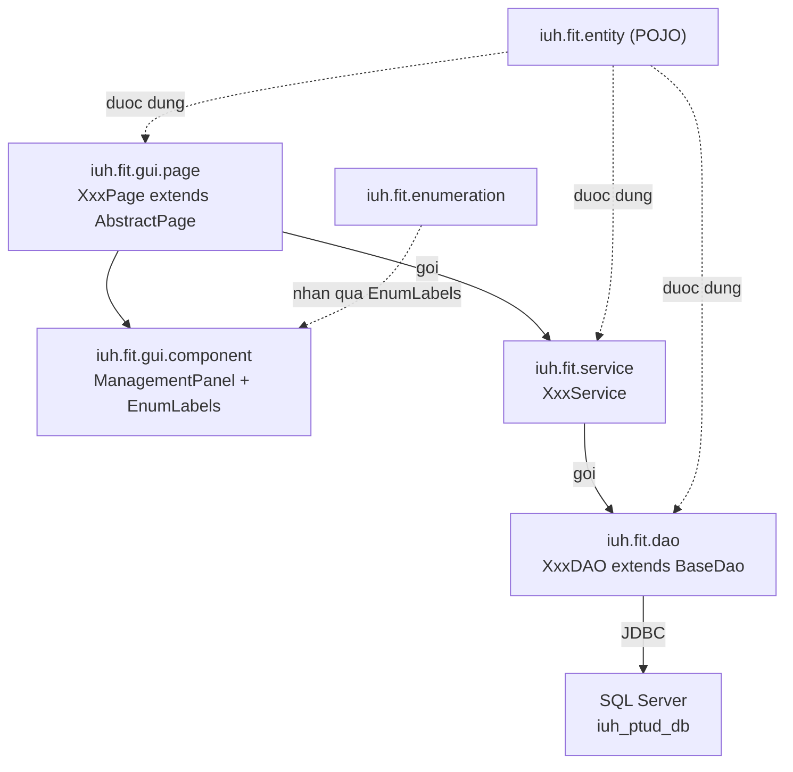

---

## 4. Bản đồ màn hình theo nhóm menu + trạng thái

Góc nhìn: **25 màn mockup** ánh xạ sang nhóm menu và trạng thái hiện tại. `[DONE]` = đã thật; còn lại thuộc lane.

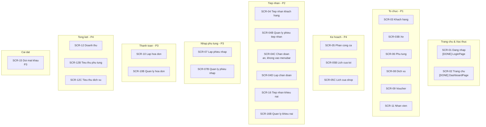

---

## 5. Quan hệ điều hướng giữa màn hình

Góc nhìn: **luồng mở màn** — từ Trang chủ tới các màn, và các cặp "thao tác ↔ quản lý".

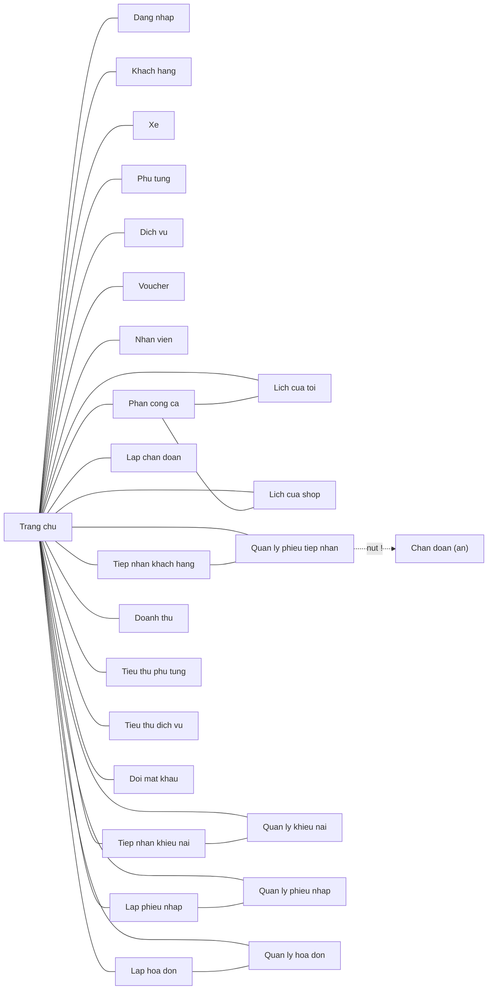

---

## 6. Mô hình dữ liệu — quan hệ thực thể

Góc nhìn: **khóa ngoại / bản số** giữa các bảng. `KhieuNai` là bảng **mới** (P2).

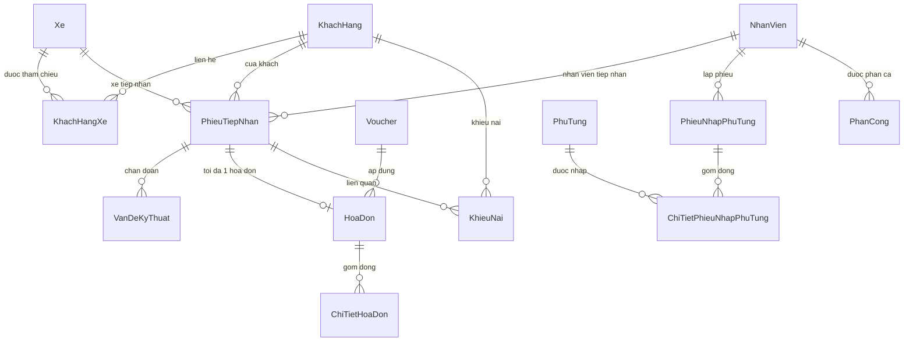

### 6b. Cụm hóa đơn — thuộc tính & trạng thái

Góc nhìn: **giá trị trạng thái thật trong DB** (khác nhãn mockup).

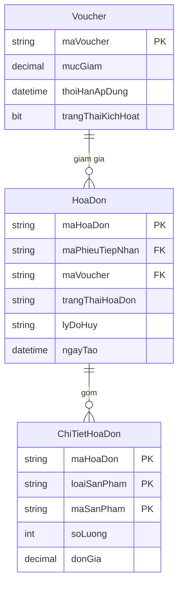

`trangThaiHoaDon` nhận giá trị thật trong DB: `CHO_THANH_TOAN`, `DA_THANH_TOAN`, `DA_HUY` (nhãn hiển thị: Chưa thanh toán / Đã thanh toán / Đã hủy).

---

## 7. Vòng đời một TaskUnit

Góc nhìn: **định nghĩa done của tuần** — khi nào một màn được coi là xong.

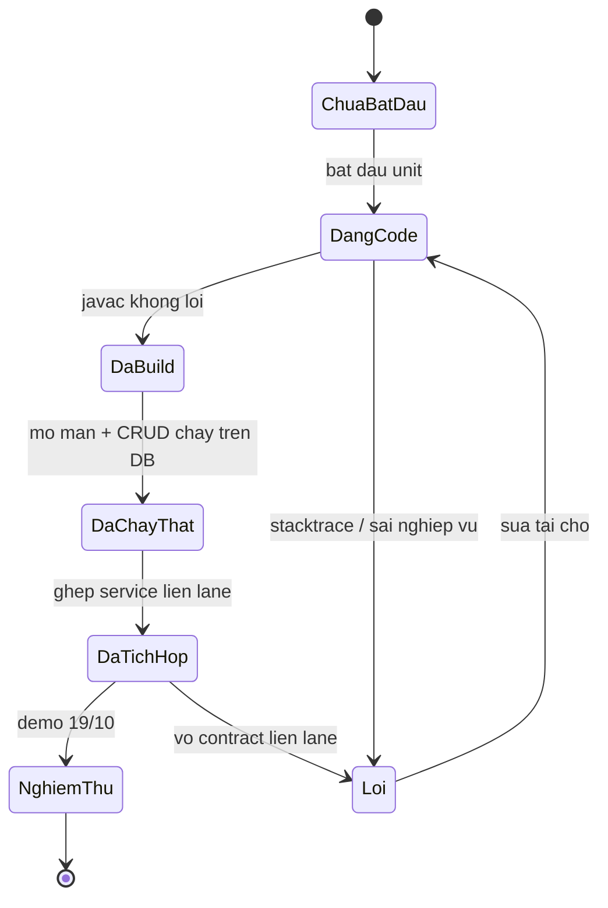

---

## 8. Mốc thời gian tuần 1 (14/10 – 19/10)

Góc nhìn: **lịch thực thi** theo ngày, tôn trọng thứ tự phụ thuộc ở mục 1.

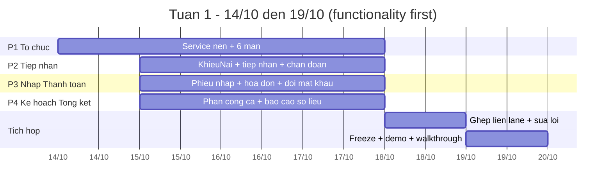

---

## 9. Trong tuần làm gì / hoãn gì

Góc nhìn: **ranh giới scope** theo "first make it work, then make it right".

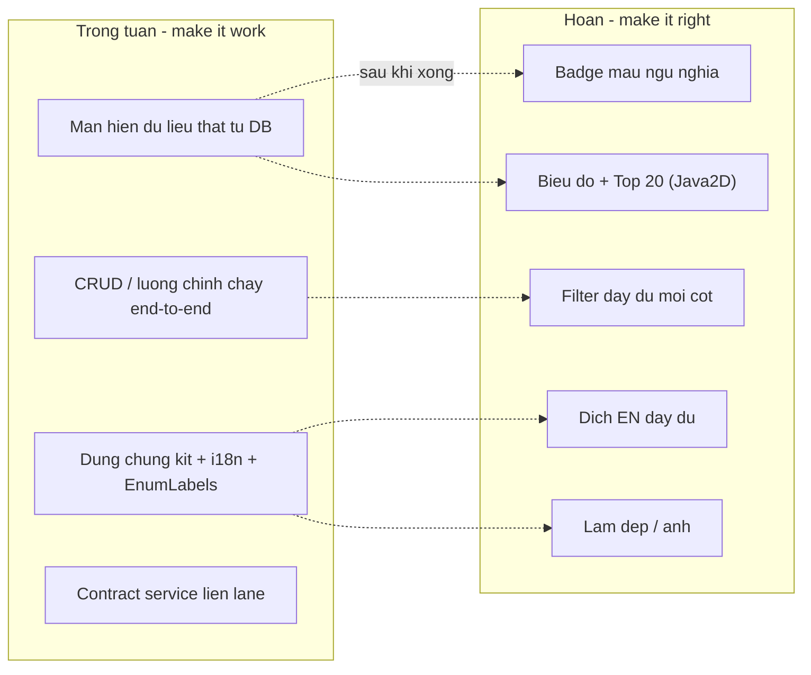

---

## 10. Quy trình nhánh Git

Góc nhìn: **mỗi lane tách nhánh từ `develop`** rồi PR ngược lại `develop`.

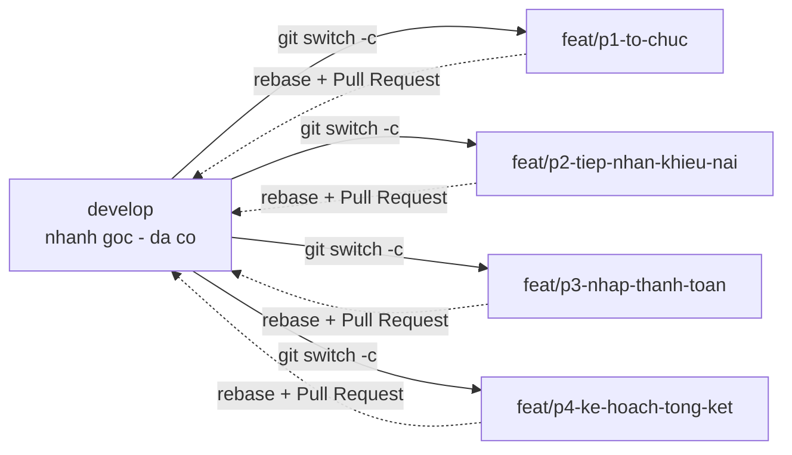

---

## Cách đọc nhanh

| Sơ đồ | Trả lời |
| :--- | :--- |
| 1 | Lane nào phụ thuộc lane nào, ai phải xong trước |
| 2 | Service nào cấp cho lane nào (điểm chốt contract) |
| 3 | Chiều phụ thuộc code bắt buộc |
| 4 | 25 màn thuộc nhóm nào, lane nào, đã xong chưa |
| 5 | Điều hướng menu và cặp thao tác ↔ quản lý |
| 6 | Khóa ngoại / bản số dữ liệu |
| 7 | Định nghĩa "xong" của một unit trong tuần |
| 8 | Lịch 14–19/10 |
| 9 | Việc làm trong tuần vs việc hoãn |
| 10 | Mỗi lane tách nhánh từ `develop` và PR ngược lại |
