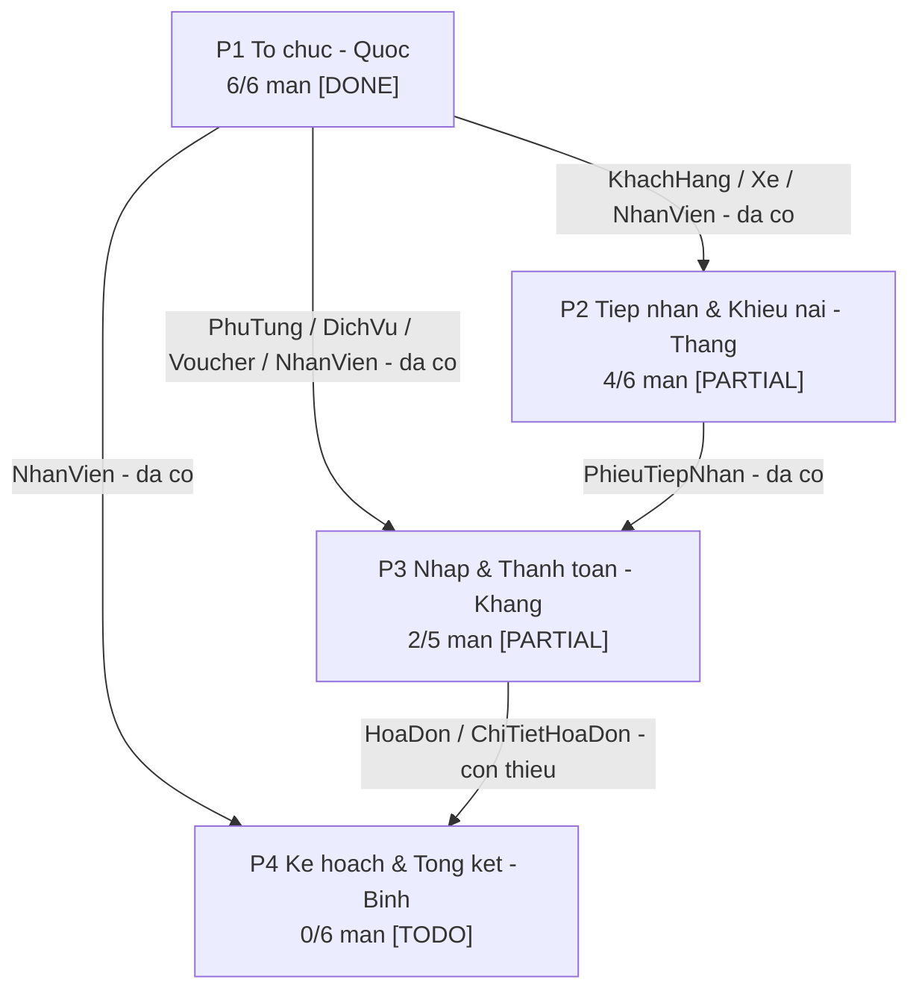
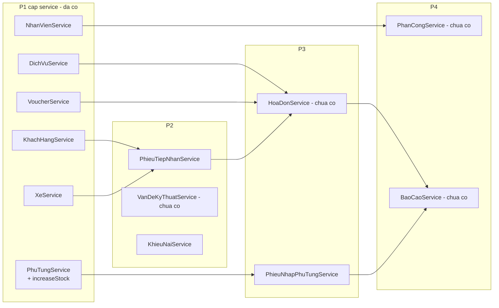
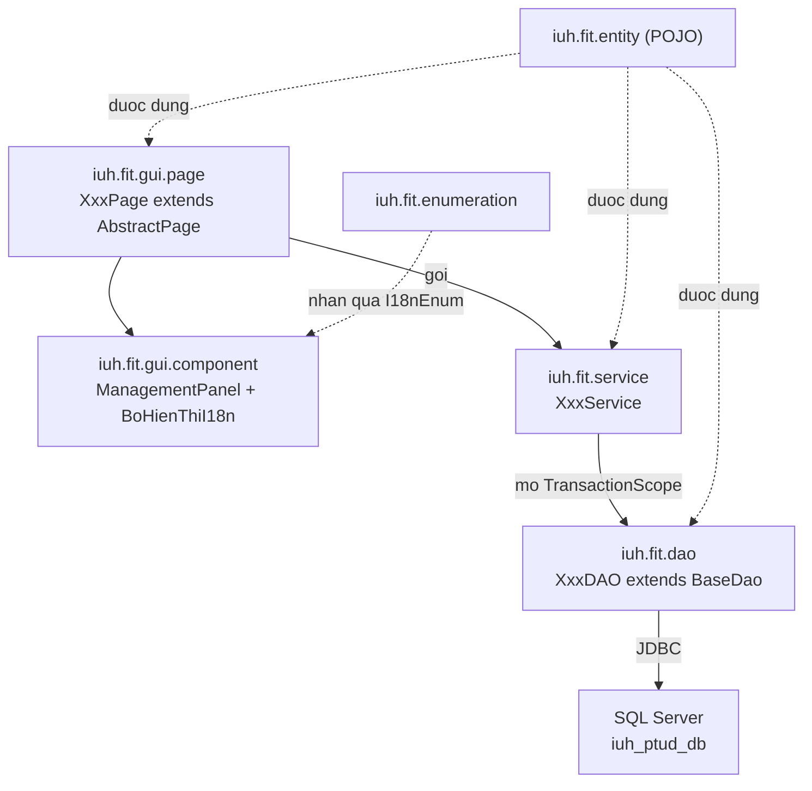
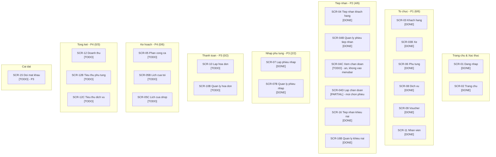
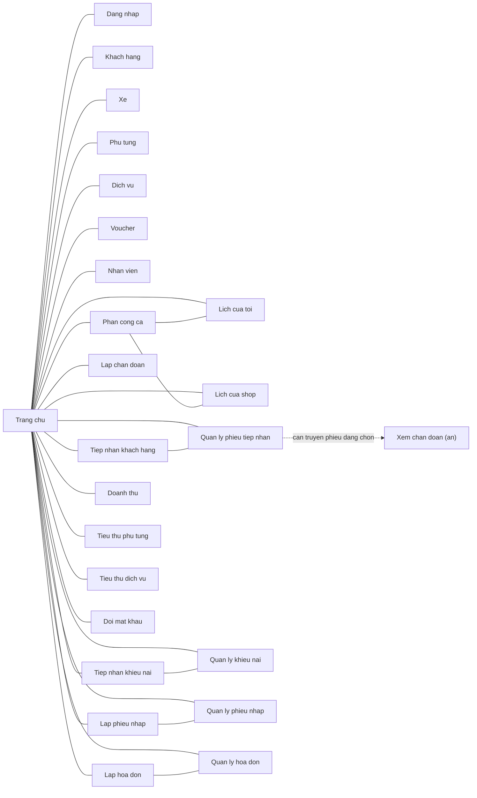
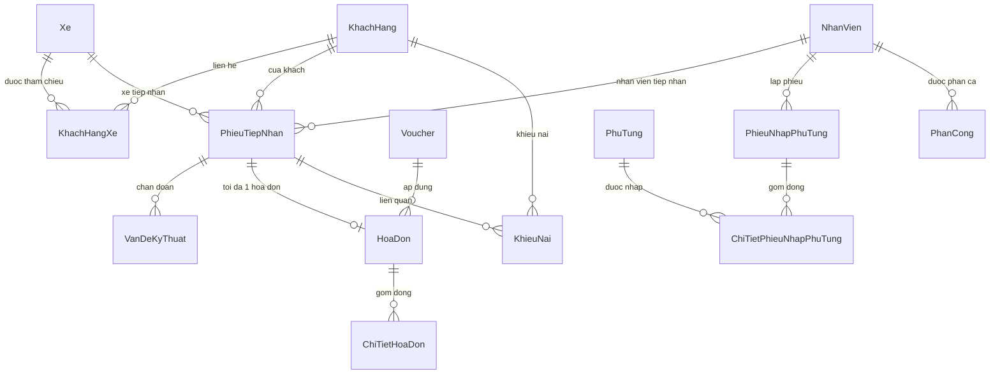
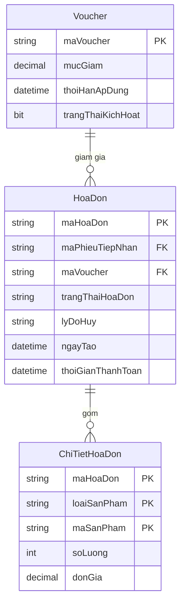
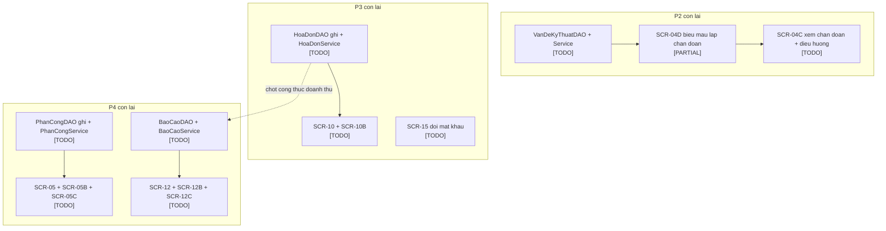
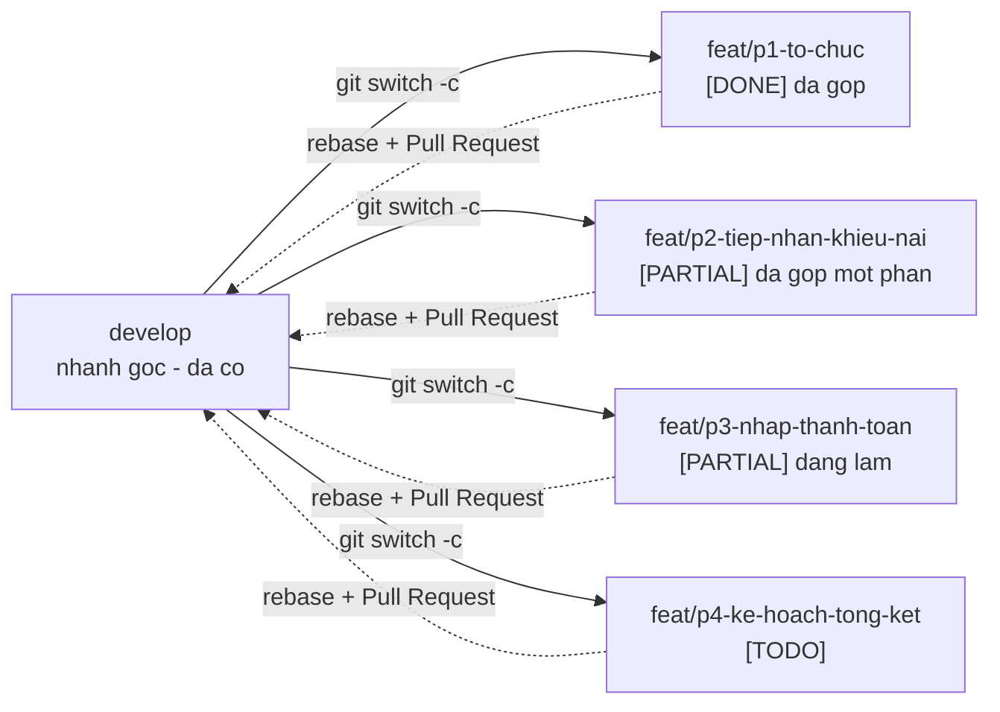

# DGRAPH — Sơ đồ phụ thuộc Gara Ô tô Lúa

Trạng thái đối chiếu mã nguồn ngày 21/10/2026. `[DONE]` đã chạy trên dữ liệu thật · `[PARTIAL]` một phần đã có mã · `[TODO]` mới có khung giữ chỗ · `[P1..P4]` lane phụ trách.

Nguồn: `assets/tasks/2026-10-14-p1..p4-*.md`, `assets/mockui/docs/screen-flow.md`, `src/iuh/fit/**`, `infra/migrations/**`.

---

## 1. Phụ thuộc giữa các lane

## 2. Contract service liên lane

Nút ghi `chua co` là phần chưa tồn tại trong mã nguồn.

## 3. Kiến trúc 3 tầng

## 4. Bản đồ màn hình theo nhóm menu

## 5. Điều hướng giữa các màn

Điều hướng nội bộ dùng `goTo(Class)` của `AbstractPage`.

## 6. Mô hình dữ liệu

Toàn bộ bảng đã tồn tại trong DB (`V0` + `V3`).

### 6b. Cụm hóa đơn

`HoaDon` không có cột tổng tiền hay tiền giảm; doanh thu phải tính từ `ChiTietHoaDon` rồi áp `Voucher.mucGiam`.

`trangThaiHoaDon`: `CHO_THANH_TOAN`, `DA_THANH_TOAN`, `DA_HUY`. `loaiSanPham`: `DICH_VU`, `PHU_TUNG`. DB không có ràng buộc duy nhất trên `maPhieuTiepNhan` hay tổ hợp nhân viên/ngày/ca của `PhanCong`; service phải kiểm tra trùng.

## 7. Việc còn lại

## 8. Trong tuần làm gì / hoãn gì

## 9. Quy trình nhánh Git

## Cách đọc nhanh

| Sơ đồ | Trả lời |
| :--- | :--- |
| 1 | Lane nào phụ thuộc lane nào, ai phải xong trước |
| 2 | Service nào cấp cho lane nào (điểm chốt contract) |
| 3 | Chiều phụ thuộc code bắt buộc |
| 4 | 25 màn thuộc nhóm nào, lane nào, đã xong chưa |
| 5 | Điều hướng menu và cặp thao tác ↔ quản lý |
| 6 | Khóa ngoại / bản số dữ liệu |
| 7 | Việc còn lại của P2, P3, P4 và thứ tự làm |
| 8 | Việc làm trong tuần vs việc hoãn |
| 9 | Mỗi lane tách nhánh từ `develop` và PR ngược lại |
