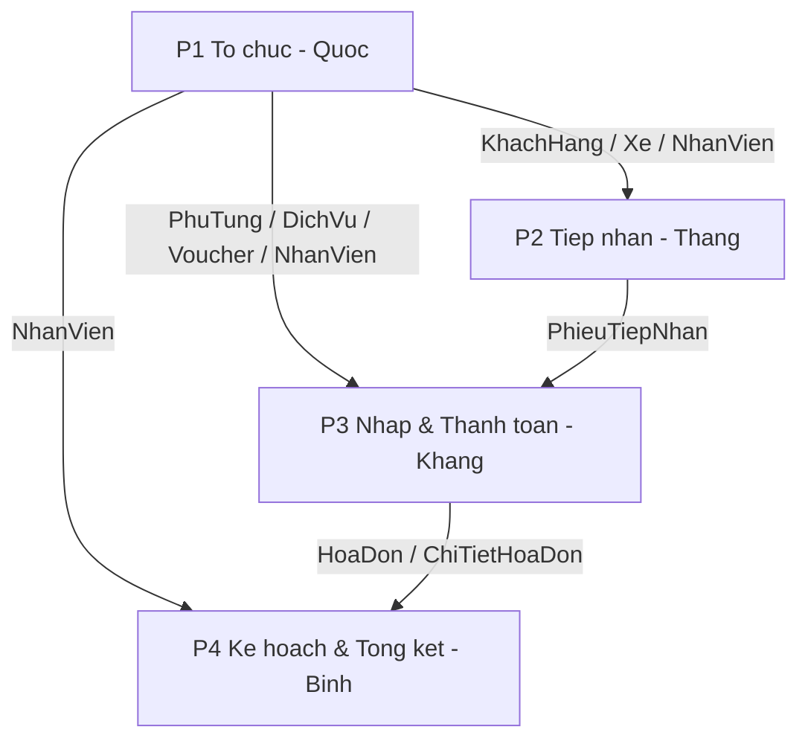

# Tasks — Gara Ô tô Lúa (Tuần 1: 14/10 – 19/10/2026)

Thư mục này chứa **kế hoạch triển khai (plan) theo lane** cho tuần 1 và sơ đồ phụ thuộc.
Nguyên tắc tuần: **`first make it work → then make it right → then make it fast`** — ưu tiên chức năng chạy được, style chỉ cần đồng bộ (dùng chung kit/i18n), **không làm đẹp**.

> Wave 0 (kit dùng chung) **đã xong**, không còn là task. Bằng chứng: `local/agents/walkthroughs/2026-10-14-p0-wave0-shared-ui-kit.md`.

## Thành viên & phân công

| Người | MSSV | Vai trò | Nhiệm vụ | Nhánh | File |
| :--- | :--- | :--- | :--- | :--- | :--- |
| Mai Thế Hào | `24681001` | Nhóm trưởng | Review + tích hợp, xử lý **file dùng chung** (`PageRegistry`, `i18n_*.json`, `AuthService`) | — (merge PR trên `develop`) | — |
| Nguyễn Minh Quốc | `24681861` | Thư ký | **P1 — L1 Tổ chức** (dữ liệu nền) | `feat/p1-to-chuc` | [`p1-to-chuc.md`](./2026-10-14-p1-to-chuc.md) |
| Trần Nguyễn Hữu Thắng | `24675701` | Thành viên | **P2 — L2 Tiếp nhận & Khiếu nại** | `feat/p2-tiep-nhan-khieu-nai` | [`p2-tiep-nhan-khieu-nai.md`](./2026-10-14-p2-tiep-nhan-khieu-nai.md) |
| Nguyễn Trần Trọng Khang | `24677691` | Thành viên | **P3 — L3 Nhập phụ tùng & Thanh toán** | `feat/p3-nhap-thanh-toan` | [`p3-nhap-thanh-toan.md`](./2026-10-14-p3-nhap-thanh-toan.md) |
| Đặng Thanh Bình | `24673191` | Thành viên | **P4 — L4 Kế hoạch & Tổng kết** | `feat/p4-ke-hoach-tong-ket` | [`p4-ke-hoach-tong-ket.md`](./2026-10-14-p4-ke-hoach-tong-ket.md) |

> Sơ đồ phụ thuộc nhiều góc nhìn: [`DGRAPH.md`](./DGRAPH.md).

## Trạng thái

| Plan | Lane | Người làm | Số màn | Trạng thái |
| :--- | :--- | :--- | :---: | :--- |
| P1 | Tổ chức | Quốc | 6 | Đang làm — mẫu Khách Hàng xong |
| P2 | Tiếp nhận & Khiếu nại | Thắng | 6 | Chưa bắt đầu |
| P3 | Nhập & Thanh toán | Khang | 5 | Chưa bắt đầu |
| P4 | Kế hoạch & Tổng kết | Bình | 6 | Chưa bắt đầu |

Đã xong trước / đầu tuần: **SCR-01 Đăng nhập**, **SCR-02 Trang chủ**, khung shell (`GUI`/`Layout`/`MenuRegistry`/`PageRegistry`), và **kit dùng chung** (`ManagementPanel`, `EnumLabels`, i18n `app.common.*`/`app.enum.*`/`app.date.*`, `PaginatedResult`, DAO `Optional`, LGoodDatePicker). Mẫu tham chiếu: [`p1-mau-khach-hang-walkthrough.md`](./2026-10-14-p1-mau-khach-hang-walkthrough.md).

## Phạm vi tuần này

**Làm (make it work):** màn hiển thị dữ liệu thật từ DB · CRUD/luồng chính chạy end-to-end · dùng chung kit + i18n + `EnumLabels` · chốt contract service liên lane.

**Hoãn (make it right — tuần sau):** badge màu ngữ nghĩa · filter đầy đủ mọi cột · biểu đồ + Top 20 (Java2D) · dịch EN đầy đủ · làm đẹp/ảnh.

## Definition of Done (một màn)

1. Không còn `PlaceholderPage`, mở được từ menu đúng nhóm.
2. Hiển thị dữ liệu thật từ DB qua `GUI → SERVICE → DAO`.
3. Luồng chính chạy end-to-end (tạo/sửa/lưu/xem tùy màn).
4. Text qua i18n key; giá trị enum hiển thị qua `EnumLabels`, không lộ code thô.

## Phụ thuộc (tóm tắt)

Kit dùng chung **đã xong** nên không còn chặn lane nào; P1 là nền dữ liệu cho P2/P3/P4.



Chi tiết đầy đủ ở [`DGRAPH.md`](./DGRAPH.md) mục 1–2.

## Lịch tuần

| Ngày | Việc |
| :--- | :--- |
| 14/10 | Mỗi lane dựng skeleton màn, dùng kit đã có; P1 ưu tiên ra service sớm |
| 15–17/10 | Luồng chức năng chính (P1 service sớm để P2/P3/P4 ghép) |
| 18/10 | Tích hợp liên lane (P3↔P1/P2, P4↔P3) + sửa lỗi |
| 19/10 | Freeze · demo end-to-end · ghi walkthrough |

## Nhánh & quy trình Git

Mỗi lane làm trên **một nhánh tách từ `develop`** — không commit trực tiếp lên `develop`/`master`.

```bash
git switch develop
git pull
git switch -c feat/p1-to-chuc      # thay bằng nhánh của bạn
# ... code ...
git add -A
git commit -m "feat(org): quan ly khach hang"
git push -u origin feat/p1-to-chuc
# mở Pull Request vào develop
```

| Lane | Nhánh (tạo bằng `git switch -c`) |
| :--- | :--- |
| P1 | `feat/p1-to-chuc` |
| P2 | `feat/p2-tiep-nhan-khieu-nai` |
| P3 | `feat/p3-nhap-thanh-toan` |
| P4 | `feat/p4-ke-hoach-tong-ket` |

- Trước khi PR, đồng bộ: `git switch develop && git pull && git switch feat/... && git rebase develop`.
- Chỉ **nhóm trưởng** rebase/merge vào `develop` và xử lý xung đột ở `i18n_*.json`, `PageRegistry.java`, `AuthService.java`.
- Commit theo Conventional Commits: `feat|fix|refactor|docs|test(scope): ...`.

## Cách dùng

- Mỗi plan có đủ `Goal`, `Người phụ trách`, `Scope`, `AffectedFiles`, `TaskUnits` (Spec + Verify), `Acceptance`, `Risks`.
- Thực thi theo `executing-plans`: chạy từng `TaskUnit`, chạy `Verify`, giữ thay đổi đúng phạm vi unit.
- Lệnh build/verify chuẩn:
  ```bash
  javac -cp "lib/*" -d bin $(find src -name '*.java') && cp -r src/resources bin/ && echo BUILD_OK
  timeout 8 java -cp "bin:lib/*" iuh.fit.Main
  ```

### Cấu hình IDE (KHÔNG commit)

Team dùng nhiều IDE (VS Code / Eclipse / IntelliJ) nên **không đẩy config IDE lên repo**. Mỗi người tự thêm classpath trỏ tới `lib/*.jar` (bắt buộc gồm `LGoodDatePicker-11.2.1.jar`, `gson`, `mssql-jdbc`) để build/chạy được:

- VS Code: `.vscode/settings.json` (file này bị gitignore) → `"java.project.referencedLibraries": ["lib/**/*.jar"]`.
- Eclipse: Project → Build Path → Add External JARs → chọn các jar trong `lib/`.
- IntelliJ: File → Project Structure → Libraries → add các jar trong `lib/`.

### Kiểm tra parity i18n

```bash
python3 - <<'PY'
import json
def keys(o,p=''):
    for k,v in o.items():
        q=f"{p}.{k}" if p else k
        if isinstance(v,dict): yield from keys(v,q)
        else: yield q
a=set(keys(json.load(open('src/resources/i18n_vn.json'))))
b=set(keys(json.load(open('src/resources/i18n_en.json'))))
print('PARITY_OK' if a==b else sorted(a^b))
PY
```
Kết quả mong đợi: `PARITY_OK`.

## Quy ước kỹ thuật (up-to-date)

- **DAO**: mọi tìm một bản ghi (`findOne`/`findById`/`findByTenDangNhap`/`login`) trả `Optional<T>` — không trả `null`. Nhiều dòng vẫn trả `List<T>`.
- **SERVICE**: không trả `null` — dùng `orElseThrow(...)` hoặc ném exception chuẩn (`iuh.fit.exception.*`); **method đặt tên tiếng Anh** (`search/create/update/delete`).
- **Danh sách rỗng** → `PaginatedResult` rỗng (`PaginatedResult.of(...)` tự xử lý), không ném lỗi.
- **Chọn ngày**: dùng **LGoodDatePicker** (`lib/LGoodDatePicker-11.2.1.jar`) qua `ManagementPanel.addDateRangeFilter(...)`; ô ngày **chỉ chọn từ lịch**; không nhập chuỗi ngày.
- **Build**: `javac -cp "lib/*" -d bin $(find src -name '*.java')` (wildcard `lib/*` đã gồm mọi jar trong `lib/`).

## Quyết định & rủi ro chung

- **Enum lấy theo DB thật**, ghi đè code trong mockup: `CHO_THANH_TOAN`, `TIEP_NHAN/DANG_XU_LY/HOAN_THANH/DA_HUY`, `HOAT_DONG/DA_KHOA`, `NHAN_VIEN_*`, `CA_SANG/CA_CHIEU/CA_NGAY`, `DICH_VU/PHU_TUNG`; nhãn hiển thị tiếng Việt theo mockup.
- **Bảng `KhieuNai` chưa tồn tại** → P2 tạo migration `V3__add_khieu_nai.sql`.
- **SCR-04C không có class Java** → P2 thêm `QuanLyChanDoanPage`, ẩn khỏi menubar.
- **Không có thư viện biểu đồ trong `lib/`** → biểu đồ hoãn; nếu làm dùng Java2D, không thêm dependency.
- **File dùng chung** (`PageRegistry.java`, `i18n_vn.json`, `i18n_en.json`, `AuthService.java`): chỉ thêm mới trong phần của mình; xung đột merge do nhóm trưởng xử lý.
- (note) `V0__init_database.sql` có dấu phẩy thừa trước `);` ở `VanDeKyThuat`; cần xác nhận DB container có bảng này trước P2.
- (note) Migration `V2__add_so_dien_thoai.sql` cần được apply trước khi chạy P1.

## Nguồn đặc tả

- `assets/mockui/.agents/skills/code-conversion/SKILL.md` — đặc tả UI 25 màn.
- `assets/mockui/docs/screen-flow.md` — luồng màn hình.
- `.agents/skills/code-convention` — quy ước code `src/iuh/fit`.
- `.agents/skills/use-lgooddatepicker` — quy ước dùng LGoodDatePicker.
- `init.sql`, `mock.sql`, `infra/migrations/` — schema + dữ liệu.
